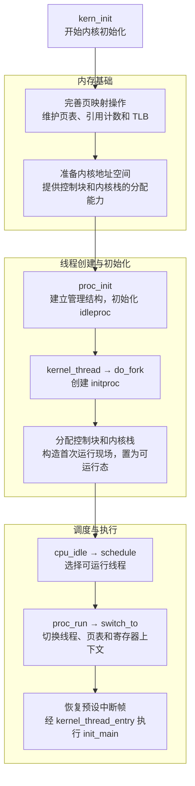
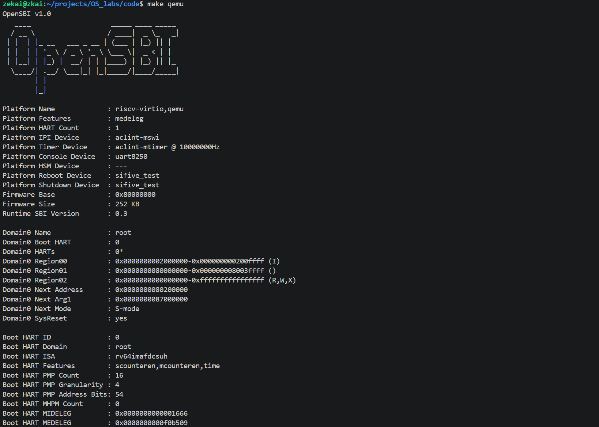
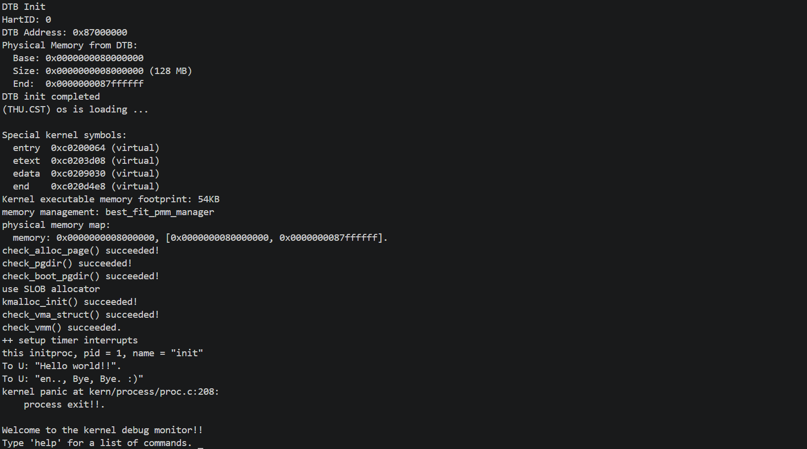
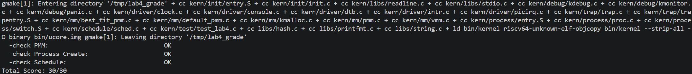

# 操作系统实验报告

## 实验基本信息

| 项目 | 内容 |
|------|------|
| **实验名称** | Lab 4: 进程管理 |
| **小组成员** | 2411268-黄泽恺、2412414-黄子恒、2412677-郑奕杰 |
| **完成日期** | 2026-11-21 |

### 小组分工

练习分工

| 成员 | 负责的练习/模块 |
|------|----------------|
| 2411268-黄泽恺 | 功能模块一：虚拟内存页操作功能 |
| 2412414-黄子恒 | 功能模块二：进程创建及初始化功能 |
| 2412677-郑奕杰 | 功能模块三：进程调度 |

实验报告分工

| 成员 | 负责的章节 |
|------|----------------|
| 2411268-黄泽恺 | [] |
| 2412414-黄子恒 | [] |
| 2412677-郑奕杰 | [] |

---

## 一、实验目的

<!-- 说明本次实验的主要目标和预期成果 -->

本实验的主要目的是：

1. 了解虚拟内存管理的基本结构，掌握虚拟内存的组织与管理方式
2. 了解内核线程创建/执行的管理过程
3. 了解内核线程的切换和基本调度过程

---

## 二、实验环境

WSL: Ubuntu-22.04。

| 成员 | AI 编程工具 | 底层模型 | 备注 |
|------|------------|---------|------|
| 2411268-黄泽恺 | ChatGPT Work | GPT-6.1 Sol | - |
| 2412414-黄子恒 | ChatGPT Work | GPT-6.1 Sol | - |
| 2412677-郑奕杰 | ChatGPT Work | GPT-6.1 Sol | - |

**说明：**
- **AI 编程工具**：指具体使用的终端工具、编辑器插件、桌面应用或浏览器界面
- **底层模型**：指该工具使用的大语言模型及版本

---

## 三、实验整体逻辑分析

### 3.1 本章节的逻辑主线

本实验围绕内核线程的创建与调度展开，在前面实验已经具备的物理内存管理、页表机制和中断处理能力上，使内核能够管理多个执行实体，并让它们轮流使用 CPU。整个实验按照“虚拟内存页操作 → 进程创建与初始化 → 进程调度与上下文切换”的顺序推进，各模块分别解决运行空间如何准备、线程如何创建和线程如何执行的问题。

内存管理为线程运行提供基础。页表记录虚拟地址到物理页的对应关系，映射的建立、替换和撤销需要同时维护页表项、物理页引用计数和 TLB。框架提供的 `mm_struct`、`vma_struct` 进一步描述虚拟地址空间及其区域属性，将地址空间的逻辑组织与具体页映射联系起来。本实验中的内核线程共享内核地址空间，每个线程拥有独立的内核栈、寄存器上下文和控制块，因此能够在共享代码与数据的同时保存各自的执行进度。

在线程管理层面，系统使用 `proc_struct` 统一记录线程的身份、状态、资源和运行现场。创建线程时，内核先分配控制块和内核栈，再构造首次运行所需的上下文，最后将线程登记为可运行状态。调度器随后从可运行线程中选择目标，通过上下文切换将 CPU 交给它。这样，启动阶段的一条执行流就逐步扩展为由内核统一管理的多条执行流。



### 3.2 功能的逐步实现

#### 3.2.1 完善虚拟内存页操作，建立线程运行所需的内存基础

首先在 `kern/mm/pmm.c` 中实现 `page_insert()` 和 `page_remove()`。`page_insert()` 借助 `get_pte()` 定位或创建页表路径，建立指定虚拟地址到物理页的映射，并处理权限更新、同页重复映射和替换旧页等情况。`page_remove()` 撤销已有映射，减少对应物理页的引用计数，并在引用归零时释放该页。页表发生变化后同步刷新 TLB，使 CPU 后续访问使用更新后的映射关系。

这一阶段把物理页分配能力与虚拟地址访问连接起来。结合框架提供的虚拟内存区域管理和 `kmalloc()`、`kfree()`，后续模块就能够分配线程控制块、准备内核栈，并使用已经建立的内核地址空间。

#### 3.2.2 初始化进程管理结构，将启动执行流纳入线程管理

接着通过 `alloc_proc()` 分配并初始化 `proc_struct`，为线程设置状态、PID、内核栈指针、上下文和链表节点等基础字段。控制块使内核能够用统一的数据结构描述不同线程，也为后续查找、登记和调度提供依据。

`proc_init()` 初始化进程链表和 PID 哈希表，并将当前从 `kern_init()` 延续下来的执行现场包装为第 0 个内核线程 `idleproc`。它复用启动栈 `bootstack`，成为 `current` 指向的当前线程，同时设置重调度标记。完成这一步后，内核启动过程便拥有了明确的线程身份，可以通过统一的调度接口让出 CPU。

#### 3.2.3 创建 `initproc`，准备新线程首次运行的完整现场

在 `idleproc` 的基础上，`proc_init()` 调用 `kernel_thread()` 创建执行 `init_main()` 的线程 `initproc`。`kernel_thread()` 将线程入口函数、参数和处理器状态组织成临时中断帧，再交给 `do_fork()` 完成创建。

`do_fork()` 依次分配控制块和独立内核栈，处理地址空间关系，并调用 `copy_thread()` 设置新线程的运行现场。本实验中，`copy_mm()` 维持内核线程共享内核地址空间的关系。`copy_thread()` 将中断帧安放在新线程的内核栈上，并设置控制块中的上下文，使线程首次被切换执行时能够进入 `forkret`。随后，内核分配 PID、建立父子关系、将线程加入管理结构，并通过 `wakeup_proc()` 将其置为 `PROC_RUNNABLE` 状态。

这一阶段完成后，系统同时拥有正在执行的 `idleproc` 和等待调度的 `initproc`。新线程的资源与入口现场已经准备好，接下来需要由调度器赋予它执行机会。

#### 3.2.4 实现调度与上下文切换，让新线程真正获得 CPU

内核完成各子系统初始化后，进入 `cpu_idle()`。当 `idleproc` 检测到 `need_resched` 被置位时，调用 `schedule()`，从进程链表中寻找下一个处于 `PROC_RUNNABLE` 状态的线程。调度器按照链表顺序选择线程，找不到可运行线程时选择 `idleproc`。

选定目标后，`proc_run()` 在屏蔽中断的临界区内更新 `current`，设置目标线程使用的页表，并调用 `switch_to()`。`switch_to()` 保存原线程的 `ra`、`sp` 和 `s0` 至 `s11`，再恢复目标线程的对应寄存器。原线程的执行位置因此得以保留，目标线程则从自己的上下文继续执行。

对首次运行的 `initproc`，创建阶段预设的上下文使执行流沿以下路径进入线程函数：

```text
switch_to → forkret → forkrets → __trapret
          → sret → kernel_thread_entry → init_main
```

其中，`forkrets` 将栈指针切到新线程的中断帧，`__trapret` 恢复寄存器和处理器状态，`sret` 跳转到预设的 `kernel_thread_entry`。该入口取出线程参数并调用 `init_main()`，由此完成从启动线程到新建内核线程的第一次执行权交接。

---

## 四、实验内容与实现

<!-- 
说明：本部分按照 exercises 文档中的练习顺序组织
每个功能模块或者练习中可能包含多项任务，请根据实际情况调整
-->

### 功能模块一：虚拟内存页操作功能

**负责人：** 2411268-黄泽恺

#### 模块功能描述

**需要实现/修改的函数：**

```c
int page_insert(pde_t *pgdir, struct Page *page, uintptr_t la, uint32_t perm);
void page_remove(pde_t *pgdir, uintptr_t la);
```

**功能说明：**

本模块负责维护 Sv39 多级页表中虚拟地址与物理页之间的映射关系，提供建立、更新和撤销单页映射的接口。操作过程中，需要使页表项、物理页引用计数和 TLB 保持一致，为内核访存、页表自检和后续地址空间管理提供基础。

`page_insert()` 根据指定的虚拟地址定位末级页表项，必要时创建中间级页表。目标地址尚未映射时，建立映射并增加物理页引用计数；已经映射到同一物理页时，更新权限并保持引用计数稳定；已经映射到另一物理页时，替换映射并减少旧页引用计数，旧页引用归零后释放。如果页表分配失败，函数返回 `-E_NO_MEM`，并回收本次操作已经分配的中间级页表页，恢复原目录项。

`page_remove()` 撤销指定虚拟地址的映射，清空末级页表项并减少原物理页的引用计数，引用归零时将该页归还给物理内存管理器。目标地址没有有效映射时直接返回，因此重复删除能够保持引用计数和空闲页统计稳定。

本模块通过 `get_pte()`、`get_page()` 和页表项转换接口访问已有页表结构，通过物理页分配器完成页表页的分配与物理页回收。实现中新增了内部辅助函数 `sync_page_table()`，复用 `tlb_invalidate()` 和 `flush_tlb()` 完成地址翻译缓存同步。上层的 `check_pgdir()`、`check_boot_pgdir()` 和 PMM 测试通过这些接口检查映射关系、权限、引用计数及实际访存结果，后续线程管理则在准备好的内核地址空间中分配和使用控制块、内核栈等资源。

#### 最终提示词

以下是经过迭代优化后，最终成功实现该功能的提示词：

````markdown
[PROMPT]

**任务**  
在 WSL Ubuntu-22.04 的 `/home/zekai/projects/OS_labs/code` 中完成 Lab4 功能模块一。实现 Sv39 页表中单个 4 KiB 页的映射建立、替换和撤销，使末级页表项、物理页引用计数和 TLB 保持一致。`pmm_init()` 会在进程初始化前调用 `check_pgdir()` 和 `check_boot_pgdir()` 验证这些操作。

**操作要求**  
直接编辑实际的 `kern/mm/pmm.c`，在 `get_page()` 与 `tlb_invalidate()` 之间的 `//LAB4 function1 2411268` 标记下补全代码。保留标记和用户已有改动，修改范围限于该处。沿用现有页表遍历和物理页分配接口，保留框架自检、评分脚本和公开函数声明。

**输出要求**  
完成后说明修改位置，并报告实际执行的编译或测试及其结果。优先用项目的 Makefile 单独编译 `pmm.c`。完整内核可构建时，在 QEMU 中检查两项启动自检，并用评分用例核对 `[Test PMM] PASS`。遇到 `kmalloc.c` 或后续模块导致的构建阻塞时，记录具体报错和未执行的检查，保持本模块的修改范围。

[RELY]

- `kern/mm/mmu.h` 提供 Sv39 页表索引 `PDX1(la)`、`PDX0(la)`、`PTX(la)`，以及 `PGSIZE`（4096 字节）和 `PTE_V`、`PTE_R`、`PTE_W`、`PTE_X`、`PTE_U` 等标志。`pde_t` 和 `pte_t` 在 `kern/mm/memlayout.h` 中定义为 `uintptr_t`。
- `kern/mm/pmm.c` 已有 `get_pte(pde_t *pgdir, uintptr_t la, bool create)`。它返回末级 PTE 的地址，返回的 PTE 内容可能无效。`create = false` 只查找，`create = true` 可分配中间级页表页。当前实现可能在挂接第一张中间级页表后，因下一张分配失败而返回 `NULL`。
- `kern/mm/pmm.h` 提供 `page2ppn(page)`、`pte_create(ppn, type)`、`pte2page(pte)` 和 `pde2page(pde)`。`pte_create()` 会设置 `PTE_V`，`pte2page()` 要求输入是有效 PTE。
- 同一头文件提供 `page_ref_inc(page)`、`page_ref_dec(page)` 和 `free_page(page)`。前两个函数返回更新后的引用计数。`pmm.c` 提供 `tlb_invalidate(pgdir, la)`，`pmm.h` 提供 `flush_tlb()`。内存不足的错误码使用 `libs/error.h` 中的 `E_NO_MEM`。
- `tools/test_lab4.c` 的 `test_lab4_pmm_basic()` 检查建映射、换页、同页重插和重复删除。框架用 `perm = 0`、`PTE_W`、`PTE_U | PTE_W` 检查软件层的 PTE 行为，实际读写验证使用 `PTE_R | PTE_W`。

[GUARANTEE]

实现以下两个已在 `kern/mm/pmm.h` 声明的接口：

```c
int page_insert(pde_t *pgdir, struct Page *page, uintptr_t la, uint32_t perm);
void page_remove(pde_t *pgdir, uintptr_t la);
```

如需复用清理逻辑，可在同一标记处添加 `static` 辅助函数。

[SPECIFICATION]

### `page_insert()`

**Pre-Condition**  
物理页分配器已初始化。`pgdir` 指向可访问的 Sv39 根页表，`page` 是已分配且由物理页管理器管理的页描述符。`la` 可带页内偏移，操作目标是它所在的 4 KiB 页。已有映射属于由引用计数管理的末级映射。

**Post-Condition**  
成功返回 `0`。目标 PTE 指向 `page`，设置 `PTE_V`，权限按本次 `perm` 设置。旧映射独有的权限随更新清除。同一物理页通过多个虚拟地址映射时，每个映射各占一次引用。

- **Case 1 · 目标无有效映射**  
  建立映射，目标物理页的引用计数增加 `1`。
- **Case 2 · 已映射到同一物理页**  
  更新权限，引用计数和空闲页数保持原值，页始终处于已分配状态。
- **Case 3 · 已映射到另一物理页**  
  建立新映射，新页引用计数增加 `1`，旧页引用计数减少 `1`。旧页的最后一个引用消失时，将它归还给物理页分配器。
- **Case 4 · 无法分配所需页表页**  
  返回 `-E_NO_MEM`。目标页仍由调用者持有，引用计数和已有映射保持原值。如果这次调用只建成了部分页表路径，撤销本次新增的目录项并回收对应页表页，保留调用前就存在的目录项。

**Requirements**  
保留框架对 `perm` 的原有约定，按传入的标志位构造 PTE。更新叶项后同步对应的 TLB，涉及中间级目录项的变动时使用全量刷新。旧页回到空闲链表前，应先让旧映射失效并完成 TLB 同步。

### `page_remove()`

**Pre-Condition**  
物理页分配器已初始化，`pgdir` 指向可访问的 Sv39 根页表。`la` 所在页可以有映射，也可以从未建立映射。

**Post-Condition**  
调用后该地址无有效映射。对同一地址重复调用时，物理页引用计数和空闲页数保持稳定。

- **Case 1 · 页表路径不存在，或末级 PTE 无效**  
  直接返回。查找过程不分配页表页，也不修改引用计数。
- **Case 2 · 末级 PTE 有效**  
  取得所映射的原物理页，清零末级 PTE，并使对应 TLB 失效。原页引用计数减少 `1`，归零时释放；还有其他映射时继续保留该页。

**Requirements**  
普通删除只撤销末级映射，中间级页表页继续由调用方管理。现有 `check_pgdir()` 会在删除映射后检查页表页引用计数，再自行回收这些页表页。
````

#### 实现迭代过程

本模块的实现经历了 1 次迭代，过程如下：

---

##### 第一次迭代

**遇到的问题：**

首次生成代码后，编译器报告以下错误：

```text
error: 'true' undeclared
error: 'false' undeclared
```

`page_insert()` 在调用 `get_pte()` 和页表同步辅助函数时使用了 `true`，`page_remove()` 调用辅助函数时使用了 `false`。项目在 `libs/defs.h` 中将 `bool` 定义为 `int`，现有代码使用 `1` 和 `0` 表示布尔值，没有提供 `true`、`false` 的定义，因此编译失败。

**问题解决策略：**

根据工程现有约定，将新增代码中的 `true`、`false` 分别替换为 `1`、`0`。这一修改保留了原有判断逻辑，使代码与项目的类型定义保持一致。

本次直接修正了代码。后续复用提示词时，可以在 `[RELY]` 中补充“项目使用 `typedef int bool`，布尔实参采用 `1` 和 `0`”，使生成代码时能够直接遵循这一约定。

**最终结果：**

经过首次生成和一次编译修正，该模块取得以下结果：

- ✅ `pmm.c` 单独编译通过。
- ✅ 在临时独立 QEMU 测试镜像中，通过 `check_pgdir()`、`check_boot_pgdir()` 和 PMM 测试。
- ✅ 通过额外的页表分配失败回滚和 TLB 映射替换验证。

**关键改进点总结：**

生成代码时，需要同时核对函数接口和工程的基础类型约定。在 `[RELY]` 中明确布尔类型及其取值方式，可以减少与现有框架不兼容的编译问题。

---

### 功能模块二：进程创建与初始化

**负责人** 黄子恒-2412414

#### 模块功能描述

本模块在 [`code/kern/process/proc.c`](../code/kern/process/proc.c#L221) 的 `LAB4 function2 2412414` 区块实现内核线程创建和初始化。启动时，`proc_init()` 先用一个 PCB 表示正在运行的 `idleproc`，再创建可供调度的 `initproc`。创建链路为 `proc_init() → kernel_thread() → do_fork()`。新线程的内核栈和执行现场由模块二准备，随后由调度器切换执行。

| 函数 | 实现要点 |
|---|---|
| `alloc_proc()` | 分配并初始化 PCB。初始状态为 `PROC_UNINIT`，PID 为 `-1`，页表物理地址为 `boot_pgdir_pa`。分配失败时返回 `NULL`。 |
| `copy_mm()` | 当前实验创建内核线程，父子线程共享启动页表，`mm` 保持为 `NULL`。该路径返回 `0`。 |
| `copy_thread()` | 在子线程内核栈高端保存中断帧副本并将 `a0` 清零。设置 `context.ra` 指向 `forkret`，`context.sp` 指向帧副本。帧中的 `gpr.sp` 用于 `sret` 后的实际执行。 |
| `do_fork()` | 准备 PCB、内核栈和首次运行现场。在本地中断保护下分配 PID、登记线程并更新计数，随后唤醒。失败时返回相应错误码并回收本次已取得的资源。 |
| `kernel_thread()` | 通过 `s0`、`s1` 和 `epc` 传递入口函数、参数和汇编入口，以 `SPP`、`SPIE` 和 `SIE` 设置首次返回状态。创建标志加入 `CLONE_VM`，创建结果原样返回。 |
| `proc_init()` | 初始化进程链表和 PID 哈希表。PID 为 `0` 的 `idleproc` 复用启动栈并成为 `current`，PID 为 `1` 的 `initproc` 通过已有创建链登记并进入就绪态。 |

#### 最终提示词与实现迭代

[模块二的六份最终 Prompt 与 Spec](prompt.md#功能模块二进程创建与初始化)按实际生成顺序编排。每个函数先确定源码依赖、接口签名和可观察的前后置条件，再单独生成并验证。第一轮细化了 `alloc_proc()` 的验证要求，使用预先填充的内存检查成功路径，并模拟分配失败。随后补齐 `copy_mm()` 和 `copy_thread()`，再验证 `do_fork()` 的登记与失败回收，最后接入 `kernel_thread()` 和 `proc_init()`。

`copy_thread()` 的规格分别描述了切换时和恢复后的两个栈指针。独立 QEMU 用例分别用零值和显式 `esp` 执行了实际的 `sret`，两条路径均恢复到预期栈位置。`do_fork()` 的用例覆盖了进程数达到上限、PCB 分配失败、内核栈分配失败和 `copy_mm()` 返回错误。最后一项由临时替身触发，实际观察到先释放栈、再释放 PCB。临时宿主测试曾因缺少 `kern/debug` 头文件搜索路径而编译失败，补齐测试命令的包含路径后通过。

#### 联调记录

测试在 WSL Ubuntu 24.04 中进行，使用 RISC-V 交叉工具链、`qemu-system-riscv64` 和 `gdb-multiarch`。

| 验证项 | 实际执行与结果 |
|---|---|
| 目标文件与整核构建 | 在 `code/` 下执行 `make obj/kern/process/proc.o` 和 `make`，均成功，生成 `bin/ucore.img`。 |
| 线程初态及首次切换 | 独立 QEMU 用例准备启动页表和测试分配器，运行当前的模块二代码及现有调度、恢复汇编。实测 `current == idleproc`、`idleproc->need_resched` 已置位、`find_proc(1) == initproc`、`initproc` 已就绪且进程总数为 `2`。首次切换进入 `init_main()`，输出 `this initproc, pid = 1, name = "init"` 和 `To U: "Hello world!!".`。 |
| 原项目启动 | `timeout 5s make qemu` 只观察到 OpenSBI 输出。用 QEMU 的 `-d int` 跟踪确认，写入 `satp` 后在 `0x80200038` 发生取指页故障。该地址对应下一条 `sfence.vma`，故障发生在 `kern_init()` 之前。 |
| 正式评分 | 使用 `make grade GDB=gdb-multiarch`，并通过命令行指定临时评分目录。评分副本构建成功，运行未到达三个评分用例，脚本报告 `Total Score: 0/30`。 |

评分副本编译时，[现有调度用例](../code/tools/test_lab4.c#L68) 向 `kernel_thread()` 传入了 `void (*)(void *)`。接口声明的入口参数类型为 `int (*)(void *)`。当前工具链报告类型警告后完成编译。

`entry.S` 的启动页表只建立了高地址映射。写入 `satp` 的那一刻，CPU 仍在低地址执行启动代码，下一条指令无法取到。启动问题和复现信息应按 [联调交接约定](成员C开发交接.md#启动问题与介入条件)交给 A 核对。启动恢复后，再记录整核 QEMU 输出、三项评分标记和总分，并配合 C 复测双线程轮转、空闲回退和调度中的中断恢复。联调提交号以组内仓库记录为准。

---

### 功能模块三：进程调度

**负责人：** 2412677-郑奕杰

#### 模块功能描述

**需要实现/修改的函数：**

```c
void cpu_idle(void);
void schedule(void);
void proc_run(struct proc_struct *proc);
void switch_to(struct context *from, struct context *to);
```

**功能说明：**

`cpu_idle()` 循环检查当前线程的 `need_resched`。初始化完成后，`current` 指向 `idleproc`，调度标志已置位，空闲线程随即调用 `schedule()`。调度器在关中断期间清除当前线程的调度请求，沿 `proc_list` 寻找 `PROC_RUNNABLE` 线程。当前是空闲线程时从表头开始，当前是普通线程时从其后继开始，越过表尾后继续查找。如果只有当前普通线程就绪，就继续执行它。如果普通线程均不可运行，就选 `idleproc`。每次选中线程都将其 `runs` 加一，目标变化时才调用 `proc_run()`。

`proc_run()` 保存本地中断状态，将 `current` 指向目标线程，把目标根页表的物理页号写入 Sv39 模式的 `satp`，刷新 TLB 后调用 `switch_to()`。汇编按 `struct context` 的字段顺序保存旧线程的 `ra`、`sp` 和 `s0` 至 `s11`，再从新线程的上下文恢复这 14 个寄存器。`ret` 使用恢复后的 `ra`，因此曾经被切走的线程会接着执行原来的 `switch_to()` 调用点之后的代码，并恢复该线程保存的中断状态。

首次运行的 `initproc` 使用模块二预设的内核栈和中断帧。`switch_to()` 恢复的 `ra` 指向 `forkret()`，`sp` 指向中断帧。`forkret()` 经 `forkrets` 进入异常返回代码，将中断帧中的返回地址和状态装入对应的 CSR。`sret` 回到 `kernel_thread_entry`，再由它将保存的参数传给 `init_main()`。

#### 最终提示词

以下是经过迭代优化后，最终成功实现该功能的提示词：

````markdown
[PROMPT]

**任务**

在 RISC-V 64 位 uCore Lab 4 中实现内核线程调度。系统启动后，空闲线程响应调度请求，将 CPU 交给就绪的 `initproc`，使它进入 `init_main()`。普通线程主动让出 CPU 后可以从原调用点继续执行。普通线程均不可运行时，CPU 回到空闲线程。

**操作要求**

直接编辑项目中的实际文件。在 `code/kern/process/proc.c` 补全 `cpu_idle()` 和 `proc_run()`，在 `code/kern/schedule/sched.c` 补全 `schedule()`，在 `code/kern/process/switch.S` 补全 `switch_to()`。沿用框架已有的进程链表、中断接口和现场恢复路径。在各文件的 `LAB4 function3` 标记处补全实现，将三个 `YOUR CODE` 替换为学号 `2412677`。

**输出要求**

依据下列接口与行为规格交付源码。使用项目 Makefile 分别编译三个目标文件，反汇编核对 `switch_to()` 的寄存器与偏移。整核验收检查 QEMU 中的 `init_main()` 输出、线程轮转、空闲回退和中断状态，并用 `make grade` 核对 `[Test Schedule] PASS`。交付时列出修改位置、实际运行的命令和观察结果。

[RELY]

- `code/kern/process/proc.h` 定义 `struct proc_struct`。调度使用 `state`、`runs`、`need_resched` 和 `list_link`，切换使用 `context`、`pgdir` 和 `tf`。其中 `pgdir` 保存根页表物理地址。候选线程的就绪状态为 `PROC_RUNNABLE`。
- `proc_list` 是带哨兵的循环双向链表，保存普通线程。使用 `list_next()` 遍历，用 `le2proc(entry, list_link)` 从普通链表节点取得进程控制块。`current` 指向当前线程，`idleproc` 指向空闲线程。
- `struct context` 的字段依次为 `ra`、`sp`、`s0` 到 `s11`，类型均为 `uintptr_t`。在 RV64 上每项占 8 字节。`code/libs/riscv.h` 提供汇编使用的 `STORE`、`LOAD` 和 `REGBYTES`。
- `code/kern/sync/sync.h` 提供 `local_intr_save(flag)` 和 `local_intr_restore(flag)`，通过 `sstatus.SIE` 保存进入临界区时的中断状态。`code/libs/riscv.h` 提供 `write_csr()`、`SATP_MODE_SV39` 和 `RISCV_PGSHIFT`。Sv39 的模式字段位于 `satp[63:60]`，根页表物理地址转换为页号后写入 PPN 字段。`code/kern/mm/pmm.c` 中的 `enable_paging()` 给出了现有编码方式，`pmm.h` 提供 `flush_tlb()`。
- 进程初始化完成后，`current == idleproc`，`idleproc->need_resched == 1`，`initproc` 已登记且处于就绪状态。新线程的 `context.ra` 指向 `forkret`，`context.sp` 指向内核栈上的 `trapframe`。框架已有 `forkret → forkrets → __trapret → sret` 路径。中断帧中的 `epc` 指向 `kernel_thread_entry`，`s0`、`s1` 分别保存线程函数与参数，`status` 提供首次返回时的特权级和中断状态。

[GUARANTEE]

实现下列四个接口，沿用框架中的签名及链接符号。

```c
void cpu_idle(void);
void schedule(void);
void proc_run(struct proc_struct *proc);
void switch_to(struct context *from, struct context *to);
```

[SPECIFICATION]

### `cpu_idle()`

**Pre-Condition**

内核初始化已进入空闲线程，`current == idleproc`，调度所需的进程状态和链表已就绪。

**Post-Condition**

函数持续承担空闲线程的执行循环。每次恢复到空闲线程时，继续检查当前的重调度请求。

- **Case 1 · 有调度请求**。`need_resched` 置位时调用 `schedule()`，由调度器选择下一执行线程。
- **Case 2 · 暂无调度请求**。保持空闲循环，等待下一次请求。

### `schedule()`

**Pre-Condition**

当前线程有效。普通线程位于已初始化的 `proc_list` 中，空闲线程由 `idleproc` 单独持有。

**Post-Condition**

本次调度清除发起线程的 `need_resched`，为选中线程的 `runs` 增加 1，并在目标发生变化时切换执行。发起线程从本次调用返回时，其本地中断使能状态恢复到调用前的值。

- **Case 1 · 存在可切换的普通就绪线程**。当前为空闲线程时从表头找起。当前为普通线程时从其后继找起，越过表尾后继续从表头查找。选择遇到的第一个就绪线程。
- **Case 2 · 当前普通线程是唯一就绪线程**。完成一轮查找后继续运行当前线程，本次调度仍计入其 `runs`。
- **Case 3 · 普通线程均不可运行**。选中 `idleproc`。如果当前已在 idle，则继续执行空闲循环。

**Requirements**

在本地中断保护下读取进程状态、确定调度目标和切换。链表哨兵只用于界定遍历，调度候选来自就绪线程和空闲线程。

### `proc_run(proc)`

**Pre-Condition**

`proc` 指向调度器选中的线程。当前线程与目标线程均有有效的控制块，目标线程具有可用的 Sv39 根页表和可恢复的上下文。

**Post-Condition**

目标线程接管 CPU 时，`current`、活动页表和 CPU 执行现场都对应目标线程。原线程的执行现场可在以后恢复。

- **Case 1 · 目标就是当前线程**。直接返回，保留当前页表、上下文和中断状态。
- **Case 2 · 目标为另一线程**。切换到目标的 Sv39 页表并同步 TLB。目标线程在其保存的现场开始或继续执行，原线程在以后恢复时接续本次调用。

**Requirements**

更新 `current`、激活页表和交接上下文的过程受本地中断保护。原线程恢复后，按它在本次调用进入临界区前保存的状态恢复中断。首次运行线程的中断状态由其 `trapframe` 在 `sret` 时恢复。

### `switch_to(from, to)`

**Pre-Condition**

`from` 指向可写的旧线程上下文，`to` 指向已准备好的目标上下文。两个参数按 RISC-V 调用约定由 `a0`、`a1` 传入，调用方已保护切换临界区。

**Post-Condition**

旧线程的 `ra`、`sp` 和 `s0–s11` 保存在 `from` 中，CPU 中对应寄存器来自 `to`。执行流从恢复后的 `ra` 继续，已运行过的线程回到原调用点，新线程进入预设入口。

**Requirements**

保存和恢复的槽位与 `struct context` 布局一致。在 RV64 上，14 个寄存器槽位的偏移依次为 0、8、16 字节，直至 104 字节。

**说明**

本节依据开发方案和实际实现整理。正式改动限于三处 `function3`，进程创建、现有 Lab 3 中断路径和评分脚本沿用团队代码，远端提交由本人审查。当前独立 QEMU 验证使用临时线程和启动条件，整核联调与正式评分以成员 B 接入并确认启动前置条件后的结果为准。
````

#### 实现迭代过程

##### 单独编译与寄存器核对

先约定模块二提供可调度的进程链表、根页表物理地址和新线程的 `context`，再实现模块三的四个接口。交叉编译通过了 `proc.o`、`sched.o` 和 `switch.o`。对 `switch.o` 反汇编后，将每条保存和加载指令与 `struct context` 对照，确认两组指令的槽位偏移均从 0 到 104 字节，间隔 8 字节。此时整核链接报 `undefined reference to proc_init`，于是先在临时副本中准备测试线程，验证调度代码。

##### QEMU 验证与合入复测

独立镜像第一次启动时，CPU 写入 `satp` 后在 `0x80200038` 触发取指页故障，执行尚未进入 `kern_init()`。为继续测试调度，在临时副本中加入启动所需的低地址恒等映射，并跳过 `check_boot_pgdir()` 自检。QEMU 随后运行到了 `init_main()`。测试线程逐项验证了只有一个就绪线程时继续运行、两个线程交替运行、无就绪线程时回到 `idleproc`，以及切回原线程后恢复原有的 `sstatus.SIE`。

启动修复合入后，内核先用临时恒等映射完成分页切换，跳到高地址后再撤销该映射。在合并后的 `ad117d5` 上用 `make grade GDB=gdb-multiarch` 复测，调度检查通过，三项总分为 `30/30`。评分用例创建两个主动调用 `schedule()` 的测试线程，并确认两个线程都执行过。整核启动输出和评分截图见[第五节](#五测试与验证)。

---

### Challenge：扩展练习

**负责人：** 2411268-黄泽恺

#### 1. 说明语句 `local_intr_save(intr_flag); ... local_intr_restore(intr_flag);` 是如何实现开关中断的

这两个宏定义在 kern/sync/sync.h 中。local_intr_save(intr_flag) 检查 sstatus 寄存器的 SIE 位，将进入临界区前的中断状态保存到 intr_flag，并关闭当前 CPU 的监督者级中断。local_intr_restore(intr_flag) 根据保存的状态决定是否重新开启中断。

```c
static inline bool __intr_save(void) {
    if (read_csr(sstatus) & SSTATUS_SIE) {
        intr_disable();
        return 1;
    }
    return 0;
}

static inline void __intr_restore(bool flag) {
    if (flag) {
        intr_enable();
    }
}

#define local_intr_save(x) \
    do {                   \
        x = __intr_save();  \
    } while (0)

#define local_intr_restore(x) __intr_restore(x);
```

具体的开关操作位于 `kern/driver/intr.c` 中：

```c
void intr_enable(void) {
    set_csr(sstatus, SSTATUS_SIE);
}

void intr_disable(void) {
    clear_csr(sstatus, SSTATUS_SIE);
}
```

进入前中断开启，退出时就重新开启；进入前已经关闭，退出时继续保持关闭。这使临界区能够嵌套使用，内层退出时不会提前打开外层关闭的中断。项目中的物理页分配与释放函数通过这种方式保护空闲链表和页数统计。

#### 2. 深入理解不同分页模式的工作原理

##### 2.1 `get_pte()` 中的两段代码为什么如此相像

Sv32、Sv39 和 Sv48 都采用多级页表。对于普通的 4 KiB 页映射，虚拟地址由多级页表索引和 12 位页内偏移组成。处理器从 `satp` 指定的根页表开始，逐级利用索引取得下一层页表，最终由末级页表项确定物理页，页内偏移保持原值。三种模式的主要差异如下。

| 分页模式 | 适用架构 | 页表层数 | 各级索引位数 | 页表项大小 | 每张页表的项数 |
|---|---|---:|---|---:|---:|
| Sv32 | RV32 | 2 | 10 + 10 | 4 字节 | 1024 |
| Sv39 | RV64 | 3 | 9 + 9 + 9 | 8 字节 | 512 |
| Sv48 | RV64 | 4 | 9 + 9 + 9 + 9 | 8 字节 | 512 |

当前项目使用 Sv39，`get_pte()` 中的遍历过程为：

```text
pgdir
  └─ PDX1(la)，取虚拟地址的第 38～30 位
       └─ 下一层页表
            └─ PDX0(la)，取第 29～21 位
                 └─ 末级页表
                      └─ PTX(la)，取第 20～12 位
                           └─ 返回对应末级 PTE 的地址
```

函数中的第一段代码处理根页表的 PDX1(la) 项，第二段代码处理下一层页表的 PDX0(la) 项。两段代码都要检查目录项是否有效，在允许创建且目录项缺失时，分配一个页表页、初始化并挂接到上一级。

因此，两段代码相像的原因是多级页表的各层具有相同的组织方式，逐层查找和创建的操作也基本相同。Sv32 到达末级页表需要经过一层目录，Sv39 需要两层，Sv48 则需要三层。

##### 2.2 是否应该将页表项查找和页表页分配拆开

我们认为当前实验中合并实现是合理的。当前 `get_pte()` 使用 `create` 参数控制行为：

```c
pte_t *get_pte(pde_t *pgdir, uintptr_t la, bool create);
```

create = 0，只查找已有页表，路径缺失时返回 NULL。

create = 1，允许分配缺失的中间级页表，分配失败时返回 NULL。

这样可以复用页表遍历逻辑，调用也比较方便。page_remove() 使用只读查找，page_insert() 则在需要时创建页表路径。函数返回的是末级页表项的地址，该项是否已有有效映射还需进一步检查。

如果后续功能更加复杂，可以拆成独立的查找接口和创建接口，让调用者明确一次操作是否会分配内存。同时，创建接口可以统一负责分配失败后的清理。例如，当前 get_pte() 可能在第一张页表分配成功、第二张分配失败后留下部分路径，本次 page_insert() 就需要负责回收。因此，本实验可以保留现有接口，后续扩展时再根据资源管理需求拆分。

---

## 五、测试与验证

<!-- 根据该实验的具体情况，提供完整的测试运行截图，应包含：
- 编译及运行成功的输出（make qemu），可能有多个
- 测试通过的结果（make grade），只有一个
-->

在项目的 `code` 目录下执行 `make qemu`，检查内核启动、内存管理初始化及内核线程运行情况；随后执行 `make grade`，验证虚拟内存页操作、线程创建和调度三个功能模块。

**测试截图：**



图 5-1 展示了执行 `make qemu` 后的启动信息。OpenSBI 将执行权交给位于 `0x80200000` 的内核入口，并进入 S 模式，为后续内核初始化提供运行环境。



图 5-2 展示了内核初始化和线程运行结果。系统识别出 128 MB 物理内存，使用 Best-Fit 分配器，并通过物理页分配、页表映射、内核映射和虚拟内存区域管理等自检。

随后，系统完成时钟初始化，成功切换到 PID 为 1、名称为 `init` 的内核线程，输出 `Hello world!!` 等信息，表明线程创建、首次运行现场恢复和上下文切换能够协同完成。`init_main()` 返回后，模板中的 `do_exit()` 调用 `panic()`，输出 `process exit!!` 并进入内核调试界面。



图 5-3 展示了 `make grade` 的评分结果，三项检查均为 `OK`，总分为 **30/30**。

---

## 六、实验总结与收获

### 对操作系统的理解

#### 6.1 本实验的重要知识点及其与 OS 原理的联系

| 知识点 | 本实验中的体现 | 与 OS 原理的联系及差异 |
|---|---|---|
| 多级页表与地址翻译 | 使用 Sv39 三级页表，通过 `get_pte()` 定位末级页表项，利用 `page_insert()` 和 `page_remove()` 管理映射 | 多级页表通过分层组织减少稀疏地址空间的页表开销。本实验主要操作普通 4 KiB 页的映射，虚拟地址空间的扩展还可以结合大页、按需分页等机制。 |
| 物理页引用计数与资源回收 | 建立、替换和撤销映射时同步维护物理页引用计数，引用归零后释放物理页 | 一个物理页可以被多个虚拟地址引用，撤销其中一条映射后，需要根据剩余引用决定是否回收。引用计数把映射关系与物理页生命周期联系起来。 |
| 页表与 TLB 的一致性 | 页表项更新后刷新相应的地址翻译缓存 | 页表保存地址映射，TLB 缓存翻译结果。修改页表后需要使旧缓存失效，CPU 后续访问才能使用新的映射和权限。 |
| 进程与线程的组织 | 使用 `proc_struct` 描述线程，记录 PID、状态、内核栈、上下文及父子关系 | 控制块是操作系统管理执行实体的基础。本实验中的内核线程共享内核地址空间，各自拥有独立的栈和执行现场；用户进程还需要管理自己的用户地址空间。 |
| 调度与上下文切换 | `schedule()` 选择可运行线程，`proc_run()` 和 `switch_to()` 完成执行权交接 | 调度负责选择运行对象，上下文切换负责保存和恢复现场。本实验采用沿进程链表查找的简单调度方式，并利用函数调用约定保存恢复所需的关键寄存器。 |
| 临界区与中断控制 | 通过 `local_intr_save()` 和 `local_intr_restore()` 保护物理页管理和线程切换中的关键操作 | 临界区保护用于避免共享状态在更新过程中被并发访问。关闭本地中断能够控制当前 CPU 上的中断交错，多核共享数据还需要锁等同步机制。 |

本实验使我们进一步理解了“线程能够运行”所需的条件。创建线程时，除了分配控制块，还需要准备内核栈、中断帧和上下文。调度发生后，新线程沿预设的恢复路径进入入口函数，已经运行过的线程则从此前保存的位置继续执行。线程的创建、调度和现场恢复因此构成了相互衔接的过程。

#### 6.2 OS 原理中重要、但本实验尚未完整涉及的知识点

1. **用户进程与特权级隔离。** 用户程序需要独立的用户地址空间，并通过系统调用进入内核，涉及用户态与内核态之间的切换、访问权限检查和参数验证。

2. **按需分页、页面置换与写时复制。** 更完整的虚拟内存系统需要在缺页时分配或调入页面，在内存紧张时选择页面换出，并通过写时复制减少进程复制的开销。本实验主要完成已有物理页的映射维护。

3. **抢占式调度与复杂调度策略。** 时间片、优先级、公平性和响应时间都会影响调度效果。本实验重点建立基本的调度与切换机制，更复杂的策略需要进一步结合时钟和调度数据结构实现。

4. **完整的进程生命周期管理。** 进程退出后还需要释放地址空间、改变状态、通知父进程并回收资源。当前模板中的 `do_exit()` 通过 `panic()` 结束执行，退出与等待机制仍有进一步扩展的空间。

5. **阻塞唤醒与多核同步。** 线程等待设备或共享资源时，需要睡眠队列和唤醒机制；多个 CPU 同时访问共享数据时，还需要考虑锁、原子操作及跨核 TLB 同步。

### AI 协作开发的经验

本次实验中，我们按照 `[PROMPT]`、`[RELY]`、`[GUARANTEE]` 和 `[SPECIFICATION]` 四段式框架组织提示词。先说明模块需要提供的能力，再列出真实接口和行为要求，能够帮助 AI 将映射、引用计数、错误处理和 TLB 同步放在同一个功能目标下考虑。

我们也认识到，提示词中的上下文需要与工程代码一致。例如，项目将 `bool` 定义为 `int`，首次生成代码使用了尚未定义的 `true`、`false`，导致编译失败。对照现有代码改用 `1`、`0` 后，模块通过编译。这说明基础类型、宏和函数签名也需要纳入上下文检查。

验证代码时，应将需求转化为具体状态检查。对于页映射模块，除了确认映射能够建立，还要检查同页重插后引用计数是否稳定、替换映射后旧页是否回收、重复删除是否安全，以及页表分配失败后资源是否恢复。通过这些场景，才能判断实现是否覆盖了完整的操作过程。

AI 帮助我们完成了需求整理、代码生成和边界场景验证。我们则需要持续核对代码是否符合项目约定，并理解每个接口维护的系统状态，使提示词、实现和测试结果能够相互对应。

---