# 操作系统实验报告

## 实验基本信息

| 项目 | 内容 |
|------|------|
| **实验名称** | Lab 2: 物理内存和页表 |
| **小组成员** | 2411268-黄泽恺、2412414-黄子恒、2412677-郑奕杰 |
| **完成日期** | 2026-10-23|

### 小组分工

#### 练习分工

| 成员 | 负责的练习/模块 |
|------|----------------|
| 2411268-黄泽恺 | 功能模块一：物理内存初始化功能及分支任务 gdb 调试 |
| 2412414-黄子恒 | 功能模块二任务一：First-Fit 分析；任务二：Best-Fit 实现、接入及补充测试 |
| 2412677-郑奕杰 | 功能模块二任务三：Buddy System 及配套测试；SLUB 选做扩展 |

#### 实验报告分工

| 成员 | 负责的章节 |
|---|---|
| 2411268-黄泽恺 | 3.1 本章节的逻辑主线；3.2.1—3.2.3；4.1 功能模块一（含 Challenge）；4.3 分支任务 |
| 2412414-黄子恒 | 3.2.4、3.2.5；4.2.1、4.2.2 |
| 2412677-郑奕杰 | 3.2.6、3.2.7；4.2.3、4.2.4 |

小组成员共同完成第五章和第六章的报告撰写

---

## 一、实验目的

本实验的主要目的是：

1. 理解页表的建立和使用方法
2. 理解物理内存的管理方法
3. 理解页面分配算法

---

## 二、实验环境

WSL:Ubuntu-22.04。

| 成员 | AI 编程工具 | 底层模型 | 备注 |
|------|------------|---------|------|
| 2411268-黄泽恺 | ChatGPT Work | GPT-6.1 Sol | - |
| 2412414-黄子恒 | ChatGPT Work | GPT-6.1 Sol | - |
| 2412677-郑奕杰 | ChatGPT Work | GPT-6.1 Sol | - |

**说明：**

- **AI 编程工具**：指具体使用的终端工具、编辑器插件、桌面应用或浏览器界面
- **底层模型**：指该工具使用的大语言模型及版本

---

## 三、实验整体逻辑分析

### 3.1 本章节的逻辑主线

本章节围绕“让内核能够发现、组织并分配物理内存”展开。在 Lab1 已经建立最小内核、能够进入 C 初始化函数并输出信息的基础上，Lab2 进一步处理内存从哪里获取、哪些页面可以使用、如何按需分配与回收等问题。页表内容为内核访问内存提供地址映射背景，物理内存管理则负责记录各页的状态和分配情况，两者共同支撑内核对内存的使用。

首先，内核需要接收并解析启动阶段传入的设备树信息，获得实际 RAM 的起始地址与大小；随后选择物理内存管理器，初始化其内部状态，再由 `page_init()` 建立页面描述符数组，保留 OpenSBI、内核镜像和管理结构所占页面，将剩余的完整页面注册为空闲区。完成这些步骤后，页面分配与回收接口才具有明确的管理对象和初始状态。

后续任务在统一的物理内存管理框架中，先分析已有 First-Fit 的空闲块组织、分配和回收流程，再实现并接入 Best-Fit，进一步自行设计 Buddy System 及其测试；SLUB 扩展则在页级分配的基础上处理不同大小的内存对象。内核运行时使用当前选定的分配器，各算法通过共同接口接入，使内存发现与初始化过程能够和具体分配策略衔接。

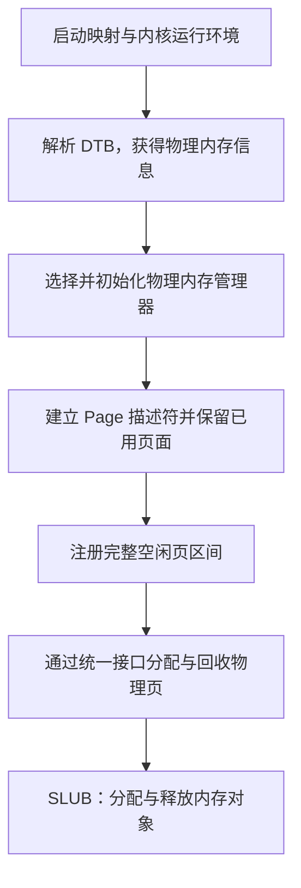

设备树提供内存范围，描述符记录物理页状态，空闲区注册建立可分配资源，分配算法决定如何使用和回收这些资源，而运行检查与配套测试用于验证各阶段的衔接与状态变化。

### 3.2 功能的逐步实现

#### 3.2.1 启动准备：启动映射、内核运行环境与 DTB 信息获取

本章的初始化建立在框架已有的启动代码之上。`entry.S` 中的 `kern_entry` 首先保存启动参数：将 `a0` 中的硬件线程编号写入 `boot_hartid`，将 `a1` 中的 DTB 物理地址写入 `boot_dtb`。设备树地址通过启动约定传递，使内核可以在尚未建立动态内存管理能力时找到硬件描述信息。

内核链接脚本将虚拟布局起点设置为 `0xFFFFFFFFC0200000`，对应当前平台上的内核物理起点 `0x80200000`，两者相差 `PHYSICAL_MEMORY_OFFSET = 0xFFFFFFFF40000000`。入口汇编提供 Sv39 启动根页表，其最后一个页表项用作 1 GiB 叶映射，覆盖内核使用的高地址区域；启动代码把根页表的物理页号与 Sv39 模式编码写入 `satp`，刷新地址转换缓存，并准备内核栈和高地址 C 入口。

进入 `kern_init()` 后，程序先对 `[edata, end)` 所指示的 BSS 区域清零，再调用 `dtb_init()`。这一顺序既满足未显式初始化的全局变量和静态变量应为零的要求，也使解析后保存的内存信息不会被后续 BSS 清零覆盖。`dtb_init()` 使用固定映射偏移访问 DTB，检查地址和魔数，再由 `extract_memory_info()` 查找内存节点的 `reg` 属性，将解析出的起点和长度保存为 `memory_base` 与 `memory_size`。

#### 3.2.2 物理内存管理框架初始化与管理器选择

获得内存信息后，`kern_init()` 调用 `pmm_init()` 进入物理内存管理初始化阶段。`pmm_init()` 首先调用 `init_pmm_manager()` 选定管理器并执行其初始化接口，然后调用 `page_init()` 建立页面描述与初始空闲区，之后通过 `check_alloc_page()` 调用该管理器的自检函数。这样的顺序保证空闲页被注册时，管理器内部的链表、计数等结构已经处于可用状态。

`struct pmm_manager` 使用函数指针统一描述不同物理内存分配器的能力，包括 `init`、`init_memmap`、`alloc_pages`、`free_pages`、`nr_free_pages` 和 `check`。对外的 `alloc_pages()`、`free_pages()` 等函数通过全局指针 `pmm_manager` 转发请求。

最终配置默认使用 Best-Fit。以 `PMM=default` 选择 First-Fit 为例，`pmm_manager = &default_pmm_manager`，使用已有 First-Fit 管理器。它的 `init` 接口初始化空闲链表头并将空闲页计数设为零，这时尚未把物理页面交给分配器。随后 `page_init()` 计算出可以使用的区间，再通过 `init_memmap()` 包装函数调用当前管理器的同名接口完成注册。

管理器初始化和空闲区注册承担不同职责：前者建立分配器的数据结构，后者把经过内存布局检查的具体页面纳入管理。将这两个步骤分开，有助于复用相同的内存探测与描述符初始化逻辑，也使后续算法能够在统一的页面表示上工作。

#### 3.2.3 物理内存探测、Page 描述符初始化与空闲页注册

`page_init()` 连接设备树解析结果和页面分配器。它读取实际 RAM 的起点与大小，检查范围是否符合当前平台约定、长度是否有效以及地址相加是否溢出，再结合内核支持的物理上界确定可管理的完整页面范围。由于后续布局计算会使用 `PADDR()`，函数需要先将 `va_pa_offset` 设置为启动映射所使用的固定偏移。

确定范围后，函数在内核结束符号 `end` 之后按页对齐安排连续的 `Page` 描述符数组，用其中的每个元素记录一个物理页的状态。数组覆盖的物理页号区间为 `[nbase, npage)`，因此元素个数是 `npage - nbase`。描述符数组也占用 RAM，必须连同 OpenSBI、内核镜像以及对齐产生的间隙一起排除在空闲区之外。

建立初始状态时，所有描述符先设为保留。函数再将描述符数组结束位置换算为物理地址并向上按页对齐，将可管理末端向下按页对齐；若中间仍有完整页面，就通过 `pa2page()` 定位起始描述符，交由 `init_memmap()` 注册。当前 First-Fit 管理器在注册过程中清除这些页面的保留状态、建立空闲块属性并更新空闲页计数，其余已占用页面继续保留。

因此，物理页分配必须安排在该阶段之后：分配器既需要知道页面对应的描述符，也需要一个已经排除占用空间的初始空闲集合。内存范围检查、元数据布局和页面状态初始化共同保证后续分配不会覆盖仍在使用的内核及管理结构。

#### 3.2.4 理解 First-Fit 连续物理内存分配与回收流程

先区分物理页与 `Page` 描述符，再阅读按地址排序的空闲链表：链表只连接空闲块首页，每块的 `property` 表示本块页数，`nr_free` 表示所有空闲页总数。`default_init()` 准备空表，`default_init_memmap()` 接收 `page_init()` 给出的可用页；随后分配函数寻找第一个足够大的块并按需拆分，释放函数将不再使用的页面归还并合并相邻块。

阅读该流程的作用是明确公共接口与具体策略的边界。页面探测、描述符对应关系不因策略变化而改变，Best-Fit 需要改变的是候选块选择，并继续正确维护链表、首页标志和计数。仅理解“找到一个空闲块”还不够，还要跟踪拆分后的剩余块以及释放后的双向合并。

#### 3.2.5 实现并接入 Best-Fit 连续物理内存分配器

以 First-Fit 的接口与状态为参考，先制定四段式提示词，再借助 AI 在 `best_fit_pmm.c` 中实现管理函数及注册对象，保留原有两个自检函数。分配时选取所有合适块中最小者，同大小优先低地址；空闲块仍按地址排列，以便回收合并。

最初在 `init_pmm_manager()` 中直接切换为 Best-Fit；同步组员后，保留三种管理器的条件编译选择，通过 `PMM=best_fit` 构建运行。原有 `check` 仍绑定 `best_fit_check()`，额外测试由 `pmm_init()` 在 Best-Fit 条件编译分支中调用，避免 Buddy 构建引用未链接的测试入口。先通过原有自检，再检查非精确最小块、同大小候选、失败不变性和资源恢复；最后通过实际内核启动和评分确认接入有效。

#### 3.2.6 实现并验证 Buddy System 分配器

伙伴系统在已有物理内存管理框架上实现按 2 的幂组织的连续页分配。首先明确块的物理对齐、请求向上取整和整块释放规则，再实现空闲区注册、块拆分及伙伴合并，通过 `pmm_manager` 接入已有的页分配接口。

配套测试独立于分配器实现，覆盖非对齐区间、不同请求大小、碎片与合并以及反复分配回收。测试先在独立页描述符夹具中检查算法，再在内核实际空闲区检查分配和归还，使后续对象分配能够依赖可用的页级接口。

初始化阶段依赖前面建立的 Page 描述符和空闲区范围，因此伙伴系统只负责组织已交付的页面，不重新探测内存。各阶链表保存不同容量的空闲块，分配时向较大阶寻找并拆分，回收时按物理页号判断伙伴，逐级恢复较大块。

这一阶段需要区分请求页数与实际占用页数，并保证保留页面不被误合并。测试同时检查地址不重叠和页数守恒，避免仅凭申请成功判断正确；完成页级验证后，SLUB 才能在其上复用小对象并回收空页。

#### 3.2.7 扩展任意大小内存单元的 SLUB 分配（选做）

SLUB 扩展在页级分配可用后，为内核提供按字节申请和释放内存的能力。小对象从按大小分类的 slab 页中取得，大对象直接向底层申请连续页面；对象全部释放后，相应页面归还页分配器。

实现 `kmalloc()`、`kfree()` 与初始化接口后，在 `pmm_init()` 之后接入对象层自检。测试检查尺寸边界、对象内容、多页分配、槽位复用及页面回收，以验证对象管理与底层页管理之间的衔接。本实验采用单核简化实现。

对象层复用统一的 alloc_pages/free_pages 接口，无须重新管理物理内存范围。每页划分元数据区与对象槽位，分配时选择合适规格，回收时更新空闲槽和活跃对象数量；大对象保存原请求页数，以适应底层伙伴系统的取整规则。

安排在页级检查之后，可以将错误区分为页面分配问题和对象状态问题。测试除核对返回地址外，还写入并校验对象内容，确认对象之间互不覆盖；释放后检查底层页数，验证对象生命周期结束时页面能够完整回收。

---

## 四、实验内容与实现

### 4.1 功能模块一：物理内存初始化功能

#### 4.1.1 任务一：实现物理内存探测与页描述符初始化功能

**负责人：** 2411268-黄泽恺

**需要实现/修改的函数：**

```c
static void page_init(void);
```

**功能说明：**

`page_init()` 位于物理内存管理初始化阶段，不接收参数也不返回结果，通过设置 `va_pa_offset`、`npage` 和 `pages`，以及向当前管理器注册空闲页来完成工作。它根据设备树提供的信息确定可管理范围，建立页面状态记录，并划定能够进入分配器的初始空闲区。`get_memory_base()`、`get_memory_size()`、`PADDR()`、`pa2page()` 和 `init_memmap()` 等均为已有依赖，本任务补全的接口是 `page_init()`。

**1. 内存范围检查与地址转换。**

函数首先读取设备树解析结果，设置 `va_pa_offset = PHYSICAL_MEMORY_OFFSET`。当前实现要求内存起点等于平台的 `DRAM_BASE`，并检查内存长度非零及 `mem_base + mem_size` 没有发生无符号溢出；无效时调用 `panic()` 终止初始化。输出的最后一个字节地址为 `mem_end - 1`，后续区间计算则使用排他末端 `mem_end`。

可管理物理上界 `maxpa` 取实际内存末端与 `PHYSICAL_MEMORY_END` 的较小值，再向下按 `PGSIZE` 对齐。这样既遵守内核支持的范围，也排除末尾不足一页的部分。函数还将内核结束位置转换为物理地址，检查内存是否足以容纳内核。默认内存布局中的 RAM 为 `[0x80000000, 0x88000000)`，其中 `[0x80000000, 0x80200000)` 按本实验布局为 OpenSBI 保留，内核镜像从 `0x80200000` 开始。

**2. Page 描述符与物理页的对应。**

`Page` 保存引用计数 `ref`、状态标记 `flags`、空闲块长度 `property` 和链表关系 `page_link`。描述符连续组成数组，其地址与它所描述的物理页地址分别计算：

| 变量或关系 | 在本模块中的含义 |
|---|---|
| `nbase = DRAM_BASE / PGSIZE` | DRAM 起始物理页号 |
| `npage = PPN(maxpa)` | 可管理物理页号的排他上界 |
| `pages` | 描述符数组的内核虚拟地址 |
| `npage - nbase` | 描述符数组的元素个数 |
| `pages[i]` 对应 `(nbase + i) * PGSIZE` | 第 `i` 个描述符所记录的物理页起始地址 |

例如，对于上述默认的 128 MiB RAM，`nbase = 0x80000`，`npage = 0x88000`，描述符数量为 `0x8000`，即 32768 个。该数量包含需要保留的 DRAM 页面，所以还需要继续标记哪些页面已经被占用。

**3. 描述符数组布局与容量保护。**

链接符号 `end` 是内核镜像结束位置的虚拟地址。函数将其向上按页对齐作为 `pages`，数组所需字节数为 `(npage - nbase) * sizeof(struct Page)`。写入任何描述符之前，先检查数组起点及其完整大小是否落在可管理内存内；容量判断使用剩余空间除以结构体大小的方式，避免先做不受约束的乘法。无法容纳描述符时调用 `panic()`。

当前布局可概括为：

```text
DRAM 起点                                                     可管理末端
   |                                                              |
   [ OpenSBI ][ 内核镜像 ][ 对齐空隙 ][ Page 数组 ][ 对齐空隙 ][ 空闲整页 ]
              内核起点      end 之后       数组自身也占用物理内存
```

数组容量确认后，函数逐个将描述符的 `flags`、`property` 和引用计数初始化，再设置保留标记。这样在明确注册空闲区以前，所有页面都具有保留状态，内核、描述符数组及相关间隙所在页面不会被提前分配。

**4. 空闲区注册与管理器交互。**

函数将描述符数组的物理结束位置向上按页对齐，得到 `freemem`。只有 `freemem < maxpa` 时，才调用 `init_memmap(pa2page(freemem), (maxpa - freemem) / PGSIZE)`。通过这一条件，注册的页数始终为正，不会出现零页注册或区间相减下溢。

`init_memmap()` 将起始描述符和页数转发给当前 `pmm_manager`。当前 First-Fit 实现在确认页面原为保留状态后，清除相应标记和计数，设置空闲块首页的 `property` 与 `PG_property`，加入空闲链表并累加空闲页数。内存范围与占用布局由 `page_init()` 确定，空闲数据结构由管理器维护。

当描述符数组能够容纳但其后没有完整空闲页时，`page_init()` 跳过空闲区注册。这个分支保证本函数不会错误注册页面；后续分配器自检是否能够继续，还取决于它所需的可用页数。当前实现针对单段连续 RAM，且没有为原始 DTB 单独保留页面；这是在内存起点和长度已保存、当前后续流程不再读取原始 DTB 的前提下采用的处理方式。

**最终提示词**

以下是经过迭代优化后，最终成功实现该功能的提示词：

````markdown
[PROMPT]

**任务**：完成 ucore Lab2“功能模块一：物理内存初始化功能”的任务一，在 `/home/zekai/projects/OS_labs/code/kern/mm/pmm.c` 中实现 `static void page_init(void)`，根据设备树提供的物理内存信息建立 Page 描述符数组，并将排除 OpenSBI、内核镜像及描述符数组占用空间后的完整空闲页面交给当前物理内存管理器。

**操作要求**：必须修改项目中的实际文件，在 `//lab2 function1 YOUR CODE` 标记处补全函数。保留已有代码和接口，本次修改限于该任务，不修改内存分配算法或切换 `pmm_manager`。

**输出要求**：依据下面的上下文、接口清单和行为规格完成实现，以项目真实代码为准。完成后简要说明内存布局、边界处理及实际执行的验证结果；无法执行的验证应明确说明。

[RELY]

**1. 初始化流程**

`kern_init()` 已在调用 `pmm_init()` 前执行 `dtb_init()`，解析并保存设备树中的内存信息。`pmm_init()` 先调用 `init_pmm_manager()` 初始化当前管理器，再调用待实现的 `page_init()`，随后执行已有的分配器检查。

**2. 已有宏定义**

以下定义已存在于工程中，直接使用，不要重复定义：

```c
#define DRAM_BASE               0x80000000
#define PGSIZE                  4096
#define PGSHIFT                 12
#define PPN(la)                 (((uintptr_t)(la)) >> PGSHIFT)

#define KERNBASE                0xFFFFFFFFC0200000
#define PHYSICAL_MEMORY_END     0x88000000
#define PHYSICAL_MEMORY_OFFSET  0xFFFFFFFF40000000
#define KERNEL_BEGIN_PADDR      0x80200000
```

工程还提供：

- `ROUNDUP(a, n)`、`ROUNDDOWN(a, n)`：向上、向下对齐。
- `PADDR(kva)`：将内核虚拟地址转换为物理地址，转换依赖 `va_pa_offset`，必须先正确设置该变量。
- `SetPageReserved(page)`、`PageReserved(page)`：设置、检查页面的保留状态。
- `panic(...)`：报告错误并终止执行。

当前工程中的 `KADDR` 宏被注释，不能直接调用。

**3. 已有数据结构与全局变量**

```c
struct Page {
    int ref;
    uint64_t flags;
    unsigned int property;
    list_entry_t page_link;
};

struct Page *pages;
size_t npage = 0;
uint64_t va_pa_offset;
const size_t nbase = DRAM_BASE / PGSIZE;
```

上述全局变量已定义，不要再次定义。

必须明确以下地址关系：

- `nbase` 是 DRAM 起始物理页号。
- `npage` 是可管理物理页号的排他上界，描述符数量为 `npage - nbase`。
- `pages` 保存描述符数组的**虚拟地址**。
- `pages[i]` 描述的物理页起始地址为 `(nbase + i) * PGSIZE`。
- 链接符号 `end` 表示内核镜像结束位置的**虚拟地址**，使用时可声明 `extern char end[];`。
- 本实验中 `[0x80000000, 0x80200000)` 为 OpenSBI 占用区，其后为内核镜像。
- 设备树中的内存信息已被保存，按本实验约定，无须额外保留原始 DTB 所占页面。

**4. 已有可调用接口**

```c
uint64_t get_memory_base(void);
uint64_t get_memory_size(void);
int cprintf(const char *fmt, ...);

static void init_memmap(struct Page *base, size_t n);
static inline struct Page *pa2page(uintptr_t pa);
```

`get_memory_base()` 和 `get_memory_size()` 返回设备树解析得到的物理内存起点与字节数。

`init_memmap()` 是当前文件中已有的包装函数，调用当前 `pmm_manager->init_memmap()`。传入的页面数量必须大于零，且对应描述符必须预先处于保留状态；空闲链表和空闲块属性由管理器负责初始化。

`pa2page()` 根据物理页号与 `nbase` 的差值定位描述符，调用时必须保证物理地址落在有效的描述符覆盖范围内。

[GUARANTEE]

必须实现以下接口，保持函数名、返回类型、参数及 `static` 属性不变：

```c
static void page_init(void);
```

函数不接收参数、不返回结果，通过更新全局变量和注册初始空闲区完成初始化。

如确有必要，可在当前文件增加少量 `static` 辅助函数，但不得改变公开接口，也不需要重新实现已有依赖函数。

[SPECIFICATION]

**page_init**

**Pre-Condition**

- 系统处于启动初始化阶段，已建立内核启动映射。
- `dtb_init()` 已执行，内存信息可通过已有接口查询；查询结果仍需检查有效性。
- 当前 `pmm_manager` 已选定并初始化，其初始空闲区为空。
- 目标为当前工程采用的 QEMU RISC-V 单段连续 DRAM 布局。

**Post-Condition**

成功完成初始化后：

1. `va_pa_offset` 与当前启动映射一致，值为 `PHYSICAL_MEMORY_OFFSET`。
2. 已输出设备树报告的物理内存起点、大小和范围，正确区分排他末端与最后一个有效字节。
3. 可管理物理内存上界不超过设备树报告的末端和 `PHYSICAL_MEMORY_END`，末尾不足一页的部分不参与管理；`npage` 与该上界对应。
4. `pages` 位于内核镜像结束位置之后，并按 `PGSIZE` 对齐；数组连续覆盖物理页号区间 `[nbase, npage)`。
5. 描述符数组自身及其覆盖的物理内存范围合法，不越过可管理上界。
6. 注册空闲区之前，全部描述符先处于保留状态。OpenSBI、内核镜像、描述符数组及相关对齐空隙所在页面不得进入空闲区。
7. 只有描述符数组之后、可管理上界之前的完整页面可以交给物理内存管理器。

**Case 1：内存信息有效，存在完整空闲页面**

建立上述描述符布局和保留状态。将描述符数组结束位置转换为物理地址，再向上按页对齐，确定空闲区起点；以向下按页对齐后的可管理上界作为空闲区末端。通过 `pa2page()` 获得起始描述符，并调用已有 `init_memmap()` 注册该连续区间，页面数量必须为正且计算准确。

**Case 2：布局有效，但没有完整空闲页面**

保持初始空闲区为空，不调用 `init_memmap()`。不得因起点大于或等于末端而发生无符号减法下溢，也不得注册零页或不完整页面。

**Case 3：内存信息无效或布局无法成立**

当设备树返回的起点或大小为零、起点加大小发生溢出、报告范围与当前平台布局不兼容，或内存无法容纳内核与描述符数组时，使用 `panic()` 终止初始化。应在写入描述符数组前确认其范围有效，避免越界访问。

**Requirements**

- 严格区分虚拟地址、物理地址、物理页号和描述符指针，采用与工程一致的地址及长度类型。
- 先设置地址转换所需状态，再使用相关转换接口；先完成描述符保留初始化，再注册空闲区。
- 从设备树读取实际内存大小，不能将默认的 128 MiB 写死为探测结果。
- 使用 `sizeof(struct Page)` 计算描述符存储空间，不假定结构体大小。
- 通过已有 `init_memmap()` 完成空闲区注册，保留后续分配器检查逻辑。

````

#### 4.1.2 扩展任务 Challenge：硬件的可用物理内存范围的获取方法（思考题）

**负责人：** 2411268-黄泽恺

如果操作系统无法提前知道当前硬件的可用物理内存范围，可以在启动阶段通过固件、引导程序或硬件描述信息获取物理内存映射，再根据内存类型和占用情况确定可分配的物理页。

**1. 通过设备树获取物理内存信息**

本实验是通过设备树 DTB（Device Tree Blob）向内核传递硬件配置信息的。DTB 中的内存节点记录 RAM 的物理地址范围，操作系统可以在启动时解析这些信息，无须在代码中预先写死内存大小。

1. **接收 DTB 地址。** 启动时，`a1` 寄存器保存 DTB 的物理地址，内核入口函数 `kern_entry` 将其保存到全局变量 `boot_dtb`。
2. **访问并校验 DTB。** `dtb_init()` 将 DTB 的物理地址转换为内核可访问的虚拟地址，并检查魔数等信息，确认设备树有效。
3. **解析内存节点。** 查找内存节点，读取 `reg` 属性，从中提取各段 RAM 的起始地址和长度。
4. **保存探测结果。** 本实验通过 `memory_base`、`memory_size` 保存内存信息，并由 `get_memory_base()`、`get_memory_size()` 提供查询接口。
5. **初始化物理页管理。** `page_init()` 根据探测结果建立页描述符，保留已占用页面，并将剩余完整页面交给物理内存管理器。

例如，若设备树报告内存起点为 `0x80000000`，长度为 `0x08000000`，则 RAM 范围为：

RAM 范围为 `[0x80000000, 0x80000000 + 0x08000000)`，即 `[0x80000000, 0x88000000)`（左闭右开）。

通过读取启动时传入的信息，操作系统可以适应不同的内存配置。

**2. 通过固件或引导程序获取内存映射**

不同启动环境提供的接口有所不同，常见方式如下：

| 启动环境 | 获取方式 | 主要信息 |
|---|---|---|
| 采用设备树启动的平台 | 解析 DTB | RAM 起始地址、长度及保留区域 |
| 传统 x86 BIOS 环境 | 调用 `INT 0x15` 的 E820 接口 | 各物理地址区间及其用途类型 |
| UEFI 环境 | 调用 `GetMemoryMap()` | 各区域的物理起点、页数、类型和属性 |

**3. 从 RAM 范围中确定真正可分配的页面**

获取 RAM 范围后，还需要排除已经占用或具有特殊用途的区域，包括：

- OpenSBI 等常驻固件占用的内存；
- 内核代码、数据、BSS、内核栈和启动页表；
- `Page` 描述符数组等内存管理结构；
- 仍在使用的 DTB、初始 RAM 磁盘等引导数据；
- 固件或设备树声明的其他保留区域。

因此，可分配页面可以表示为：

```text
可分配页面 = FullPages((R ∩ M) ∖ B)
```

其中：

- `R` 表示探测到的 RAM 区间集合；
- `M` 表示当前内核能够管理的物理地址范围；
- `B` 表示保留区和已占用区域；
- `FullPages` 表示仅保留完整页面；`∩` 表示取交集，`∖` 表示扣除区域。

对于扣除保留区域后的每个区间，应将起点向上按页对齐、末端向下按页对齐，仅将非空的完整页面区间加入分配器。如果内存不连续，则应逐段处理，不能把不同 RAM 区间之间的地址空洞当作可用内存。

### 4.2 功能模块二：物理内存分配功能

#### 4.2.1 任务一：理解 First-Fit 连续物理内存分配算法（思考题）

**负责人：** 2412414-黄子恒

##### 模块功能描述

**需要实现/修改的函数：** 无。本任务分析现有 `default_pmm.c`；本地添加阅读注释，没有改写 First-Fit 算法和原测试。

First-Fit 使用按物理地址递增排列的双向循环链表。每个节点对应一个空闲块的首页，其 `property` 记录连续页数，`PG_property` 标记其首页身份。块内其他页不单独入链，`nr_free` 是所有空闲块页数之和。`PG_property` 清零只能说明该页不是有效空闲块首页，不能单独据此断定其已分配。

| 核心函数 | 作用及主要状态变化 |
|---|---|
| `default_init()` | 将空闲链表头指向自身，`nr_free` 清零；准备管理结构，尚未登记具体页面 |
| `default_init_memmap(base, n)` | 接收已确认可用且原处于保留状态的连续 n 页；清理状态和引用计数，在首页记录块长度并设置首页标志，按地址插入链表，空闲总数增加 n |
| `default_alloc_pages(n)` | 先检查总量，再从链表头选择第一个 `property >= n` 的块；摘除首页，整块匹配直接交付，否则将后缀作为新空闲块放回原位置；清除分配首页标志，总数减少 n |
| `default_free_pages(base, n)` | 接收调用者已停止使用的合法分配区间，清理页状态，登记新空闲块并按地址插回；依次与物理相邻的前后块合并，空闲总数仅增加归还的 n 页 |

选择 First-Fit 时，从启动到分配的调用关系为 `pmm_init() -> init_pmm_manager() -> default_init()`，随后 `page_init()` 通过 `init_memmap()` 转交具体可用页面。运行时的公共 `alloc_pages()` 和 `free_pages()` 只是转发至当前管理器，算法实现位于回调内部。

以描述符下标为例：初始 `[100,110)` 共 10 页空闲，先申请 3 页得到 `[100,103)`，再申请 2 页得到 `[103,105)`，剩余 `[105,110)`。先归还前 3 页后形成两个不相邻空闲块，不能跨过仍被使用的中间两页合并；再归还中间两页，才可向前、向后合并为一个 10 页块。释放表示归还使用权，合并只是重新组织空闲资源；内存内容通常不会因释放自动清零，原调用者不得继续访问已释放页面。

前向合并判断 `p + p->property == base`，后向合并判断 `base + base->property == p`。这利用连续描述符对应连续物理页的关系。合并前块后要更新当前首页，再检查后块；旧首页退出链表并清除标志。总空闲页足够仍可能因外部碎片分配失败，例如不相邻的 3 页块和 4 页块不能满足连续 5 页请求。

**思考题：First-Fit 算法是否有进一步的改进空间？**

有。设空闲块数量为 k，查找最坏为 O(k)，释放 n 页还要逐页更新状态并寻找插入位置，约为 O(n+k)。可采用 Next-Fit 保存上次查找位置，减少反复扫描低地址块，但增加游标维护且不保证碎片更少；也可建立大小分级链表或索引，加快候选查找，代价是元数据及拆分合并时的同步维护。Best-Fit 是另一种选择策略，能缩小本次分配的剩余块，但不保证整个请求序列的碎片最少。

实现层面，阅读发现现有尾部插入分支缺少立即退出循环的处理，后续迭代可能再次访问刚插入的节点。这是代码路径分析发现的潜在链表维护问题，对该算法保留原实现及注释；Best-Fit 改用先定位再插入一次的辅助函数，避免复制该风险。释放接口的断言也不等于完整的分配历史追踪，调用者仍应保证区间合法且未重复释放。

#### 4.2.2 任务二：实现 Best-Fit 连续物理内存分配算法

**负责人：** 2412414-黄子恒

##### 模块功能描述

**实际实现或修改的函数及注册对象：**

```c
// best_fit_pmm.c：分配器实现及内部辅助函数
static void best_init(void);
static void best_insert_block(struct Page *base);
static void best_init_memmap(struct Page *base, size_t n);
static struct Page *best_alloc_pages(size_t n);
static void best_free_pages(struct Page *base, size_t n);
static size_t best_nr_free_pages(void);
const struct pmm_manager best_fit_pmm_manager;

// best_fit_pmm.c：新增测试，不修改原有 basic_check / best_fit_check
static void best_test_state(size_t blocks, size_t total);
static void best_test_drain(void);
static void best_test_selection(struct Page *arena);
static void best_test_merging(struct Page *arena);
void best_fit_run_extra_checks(void);

// pmm.c：接入与补充测试调度
static void init_pmm_manager(void);
void pmm_init(void);
```

**1. 内部状态与可用页注册。** 使用模块静态 `free_area`，用 `free_list` 和 `nr_free` 宏兼容原有测试保存、清空及恢复状态的方式。`best_init()` 建立空链表；`best_init_memmap()` 检查输入页的保留状态，清零引用计数与属性，解除保留，将区间作为空闲块交给 `best_insert_block()`。初始化布局和排除已占用页面仍由 `page_init()` 负责，Best-Fit 模块不重新探测内存。

**2. 最佳适配分配。** `best_alloc_pages(n)` 要求 n 为正。若总量不足立即返回 NULL；否则遍历按地址排序的链表，仅在新候选更小时更新最佳块。同大小不覆盖原候选，因此保持低地址优先；遇到大小恰好为 n 的块可结束。无候选时返回 NULL，不修改资源状态。选中后从块前部交付 n 页，剩余后缀用新的首页记录并回到原位置，清除已分配首页标志，空闲页数减少 n。它选择最小合适块，而非只寻找精确匹配、找不到就退化为 First-Fit。

**3. 回收与相邻合并。** `best_free_pages()` 检查可直接识别的非法状态，清零回收页的状态和引用计数，建立空闲块并增加 n 页。`best_insert_block()` 先找到第一个地址不低于新块的节点，在它之前插入一次，再按物理连续关系合并前后块。向前合并后更新当前首页，向后合并时移除旧首页，合并本身不重复增加计数。注册和释放共用该辅助函数，保持排序、不重叠与空闲页守恒。合法区间仍由调用者保证，不声称这些断言能够检测任意野指针或所有重复释放。

**4. 管理器接入。** `best_fit_pmm_manager` 按统一接口注册，`.check` 直接绑定未修改的 `best_fit_check()`。当前集成版本使用 `make qemu PMM=best_fit` 编译并选择本模块，默认 `make qemu` 使用 Best-Fit，通过 `PMM=buddy` 选择 Buddy。`pmm_init()` 在原有检查后，仅在 `PMM_BEST_FIT` 下调用跨这两个实现文件的补充测试入口；没有修改头文件结构或已有公开分配接口。这样保留现有的管理器构建选择，也避免 Buddy 构建引用 Best-Fit 专用符号。

**5. 测试与资源恢复。** 补充测试从真实管理器申请连续 32 页，暂存真实空闲链表和计数，再仅在该区间内构造布局。断言核对返回位置、块大小、双向链接、页面标志及空闲总数；结束后恢复真实链表并归还 32 页，检查总数回到基准。具体用例和辨错结果见 5.1，不用评分器的管理器指针检查代替算法行为验证。

**思考题：Best-Fit 算法是否有进一步的改进空间？**

当前分配最坏遍历 k 个空闲块，时间 O(k)，释放或注册 n 页约为 O(n+k)。可额外维护按块大小组织的平衡树或分级索引以减少搜索，同时保留按地址组织的信息供合并使用，但拆分和合并时必须同步维护两套关系，增加空间与正确性负担。精确匹配提前退出已用于减少部分扫描。Best-Fit 仍可能产生很小的外部碎片，是否优于 First-Fit 应结合请求分布、失败率和扫描长度测量，不能仅凭名称断言更优。本实验不要求复杂度优化，先满足接口、不变量和测试要求；并发锁、分配历史校验和更丰富的异常测试可作为后续工作。

##### 最终提示词

最终代码保留 `PMM` 参数选择，并仅在 Best-Fit 分支运行补充测试。后续集成不回写为最初生成过程。

````markdown
[PROMPT]

**任务**：在'`kern/mm/best_fit_pmm.c`'中标有`//lab2 function2-2 YOUR CODE`的位置实现接入
Best-Fit 连续物理页分配器，并注册`best_fit_pmm_manager`，能够被上层调用，能替换当前内核使用的First-Fit物理内存管理器。

**对应会涉及两个文件**：

1. `code/kern/mm/best_fit_pmm.c`：
在 `lab2 function2-2 YOUR CODE` 标记处补齐分配器内部状态、初始化、空闲区注册、分配、释放、空闲页计数和管理器注册（具体实现和First-Fit里的步骤相似）

2. `code/kern/mm/pmm.c`：
选择 `best_fit_pmm_manager`，能替换当前内核使用的First-Fit物理内存管理器。

**操作要求**：

- 必须修改项目中的实际文件，而不是仅展示代码片段。
- 先阅读工程真实代码，再完成实现。
- 保留 `basic_check()`、`best_fit_check()` 两个原有测试函数，不得修改其内容。
- 保留已完成的 `page_init()`。
- 保留 `default_pmm.c` 中的现有代码及学习注释。
- 不修改已有接口、头文件中的结构体。
- 保留本任务的 lab2 注释，将 `YOUR CODE` 替换为学号 2412414。
- 不实现其他无关功能。
- 你需要自行设计Best-Fit分配器的内部状态和相关管理函数，并定义'`best_fit_pmm_manager`'完成注册。

**输出要求**：

直接在标记位置写入完整的实现，保留文件中的现有代码与测试函数。
依据以下 RELY、GUARANTEE 和 SPECIFICATION 完成实际文件修改。
实现必须符合'`basic_check()`'和'`best_fit_check()`'所依赖的状态约定，能通过这两个测试函数并且正常编译运行。
实现后需要在'`kern/mm/pmm.c`'的`init_pmm_manager()`'中把`pmm_manager`指向`best_fit_pmm_manager`，实现best_fit在内核中的运行。
未执行的检查必须明确标注，不得把预期结果当作实际结果。

[RELY]

参考 `kern/mm/default_pmm.c` 的 First-Fit 实现。
现有接口和数据结构以 `pmm.h`、`memlayout.h`、`list.h` 为准。

**`struct pmm_manager` 已定义以下成员**：

```c
const char *name;
void (*init)(void);
void (*init_memmap)(struct Page *base, size_t n);
struct Page *(*alloc_pages)(size_t n);
void (*free_pages)(struct Page *base, size_t n);
size_t (*nr_free_pages)(void);
void (*check)(void);
```

**`struct Page` 中**：

- `ref`：页面引用计数。
- `flags`：页面状态。
- `property`：空闲块首页记录的连续页数。
- `page_link`：空闲链表节点。

`free_area_t` 包含 `free_list` 和 `nr_free`，分别表示空闲链表头和
空闲页总数。已有测试直接访问并保存、恢复这两个状态，必须兼容。

**可使用已有的**：

- `PageReserved`、`PageProperty` 及相应 `Set/Clear` 宏；
- `list_init`、`list_empty`、`list_next`、`list_prev`、`list_add_before`、`list_del` 等链表操作；
- `le2page`、`set_page_ref`、`assert`。

`page_init()` 会将仍处于保留状态的连续可用页，
通过 `init_memmap(base, n)` 交给当前管理器。

[GUARANTEE]

**在 `best_fit_pmm.c` 中实现**：

```c
static void best_init(void);
static void best_init_memmap(struct Page *base, size_t n);
static struct Page *best_alloc_pages(size_t n);
static void best_free_pages(struct Page *base, size_t n);
static size_t best_nr_free_pages(void);

const struct pmm_manager best_fit_pmm_manager;
```

**提供与测试兼容的状态**：

```c
static free_area_t free_area;
#define free_list (free_area.free_list)
#define nr_free (free_area.nr_free)
```

管理器 name 为 "`best_fit_pmm_manager`"，各接口绑定对应实现，check 绑定原有 `best_fit_check()`。

**修改 `pmm.c` 中**：

```c
static void init_pmm_manager(void);
```

使其选择 `best_fit_pmm_manager`，保留名称输出和初始化调用。
允许新增模块内部的 static 辅助函数和内部宏；
不修改公开接口及 `basic_check()`、`best_fit_check()`测试检查。

[SPECIFICATION]

**共同状态约束**

所有正常完成的操作均应保持：

- 空闲链表结构有效，按块起始物理地址递增排列。
- 各空闲块互不重叠，每个块首页仅登记一次。
- 首页标志及块长度正确，块内非首页不设置 PG_property。
- 物理相邻的空闲块合并为一个块。
- 各空闲块页数之和等于 nr_free。
- 保留页和仍被调用者使用的页面不属于空闲资源。

**best_init**

**Pre-Condition**：
管理器尚未登记页面，没有需要保留的活动分配。

**Post-Condition**：
空闲链表初始化为空，nr_free 为 0，可接收后续空闲区注册。

**best_init_memmap**

**Pre-Condition**：
管理器已初始化，n > 0；base 起的 n 个描述符有效、连续，
对应页面处于保留状态，且未被登记到分配器。

**Post-Condition**：
输入页面解除保留，引用计数清零，成为可分配资源；
正确登记空闲块并合并物理相邻块，nr_free 增加 n，
区间外的页面不受影响。

**best_alloc_pages**

**Pre-Condition**：
管理器状态有效，正常调用要求 n > 0。

**Post-Condition**：
正常返回后，页面状态、空闲链表和计数保持一致，
其他活动分配不受影响。

**Case 1：存在合适空闲块**
选择页数不少于 n 的最小块，大小相同时选择低地址块。
返回其前部连续 n 页的首页描述符；返回区间不再属于空闲资源，
剩余部分继续可分配，nr_free 减少 n。

**Case 2：不存在合适空闲块**
返回 NULL，不改变页面状态、链表或计数。
总空闲页数足够，但没有足够大的单个连续块时，也应失败。

**Requirements**：
n == 0 属于非法调用，应触发断言；
它与资源不足时正常返回 NULL 的情况不同。

**best_free_pages**

**Pre-Condition**：
管理器状态有效，n > 0；base 起的 n 页由调用者合法持有且已停止
使用，不包含保留页，也不与现有空闲区重叠。

**Post-Condition**：
输入页面重新成为空闲资源，引用计数清零，nr_free 增加 n。
无论两侧均不相邻、仅一侧相邻或两侧均相邻，都正确登记并合并；
结果块的首页、长度和链表关系满足共同约束。

**Requirements**：
合并不重复增加空闲页数。
零页释放及可直接识别的非法页面状态应触发断言；
不要求实现完整的分配历史追踪或任意野指针检测。

**best_nr_free_pages**

**Pre-Condition**：
管理器已初始化且状态有效。

**Post-Condition**：
返回当前空闲页总数，不修改管理器状态。

**管理器注册与内核接入**

`best_fit_pmm_manager` 各成员正确绑定。
选择 `PMM=best_fit` 时，初始化流程输出正确管理器名称，
先初始化其内部状态，再注册可用页面，随后执行原有自检。
其他管理器的构建和运行不受影响。

**模块验证要求**

保留并执行原有两个测试函数。分析已有覆盖后，新增独立测试，
至少验证：

- 无精确匹配时，从多个合适块中选择最小者；
- 精确匹配，以及同大小候选的低地址优先；
- 整块分配与拆分后的剩余块；
- 总量不足、连续块不足时失败且状态不变；
- 空表及不同位置插入；
- 无合并、单向合并和双向合并；
- 重复分配回收后的链表一致性和页面资源恢复。

各用例说明初始布局、操作、预期结果和断言依据。
测试仅使用合法取得的资源，结束后恢复资源和管理状态，
不影响原有自检或后续运行。

使用当前环境完成编译和内核运行，确认实际选择 Best-Fit，
原有自检和补充测试均通过。可以额外使用代码包的评分脚本，
但不能用评分结果代替算法行为验证。

记录实际命令、结果、遇到的问题及处理方法，
说明补充测试能够发现哪些原有测试未覆盖的错误。
不得修改测试期望或伪造输出使检查通过。
````

#### 4.2.3 任务三：实现 Buddy System（伙伴系统）分配算法

**负责人：** 2412677-郑奕杰

##### 模块功能描述

**需要实现/修改的函数：**

```c
static void buddy_init(void);
static int request_order(size_t n);
static void insert_block(struct Page *base, unsigned int order);
static void buddy_init_memmap(struct Page *base, size_t n);
static struct Page *buddy_alloc_pages(size_t n);
static void buddy_free_pages(struct Page *base, size_t n);
static size_t buddy_nr_free_pages(void);
static void buddy_check(void);
void buddy_test(void);
static void init_pmm_manager(void);
```

**功能说明：**

`buddy_pmm.c` 实现伙伴分配器，`buddy_test.c` 提供独立测试。管理器通过 `buddy_pmm_manager` 注册六个回调，供已有 `alloc_pages()`、`free_pages()` 和 `nr_free_pages()` 转发调用。`init_pmm_manager()` 根据构建配置选择管理器；默认配置为 Best-Fit，`PMM=buddy` 选择 Buddy，`PMM=default` 选择 First-Fit；构建产物位于 `code/bin` 和 `code/obj`。

**1. 空闲块组织与初始化。**

`buddy_init()` 初始化 0～15 阶空闲链表和空闲页计数，每阶管理容量为 `2^order` 页的块。`buddy_init_memmap()` 接收已被标记为保留的初始区间，按真实物理页号对齐切分成可管理的块，并通过 `insert_block()` 加入空闲集合。区间起点和长度不必是 2 的幂，首尾页面均纳入管理；多段注册时，保留区域不能参与合并。

**2. 请求取整与逐级拆分。**

`request_order()` 将正页数转换为能容纳请求的最小阶。`buddy_alloc_pages()` 从该阶向上寻找空闲块，逐级拆分，将未使用的另一半放回对应链表。返回地址按实际块容量对齐，空闲页数按实际容量扣减。例如申请 3 页占用 4 页；0、超过最大块和内存不足的请求返回 NULL。

**3. 释放校验与伙伴合并。**

空闲块头的 `Page.property` 保存阶数，已分配块头保存原请求页数，另用 `flags` 的第 2、3 位记录分配头与占用状态。释放必须传入原块首地址和原请求页数；释放 3 页请求时归还实际占用的 4 页，不支持拆开释放。

`buddy_free_pages()` 先检查范围、分配状态、请求大小和引用计数，再回收页面。伙伴页号由 `page2ppn(base) ^ (1 << order)` 得到，只有范围内的同阶空闲块头才能合并；每次合并后继续检查上一阶。相邻但不互为伙伴的块不能合并，重复释放和内部页释放通过断言拒绝。

**4. 配套测试与覆盖。**

`buddy_check()` 保存真实管理器状态，调用 `buddy_test()` 在 128 个页描述符的独立夹具上测试，恢复状态后再完成一次真实内存的 3 页申请与归还。测试通过公开回调检查结果，不复制分配算法作为判断依据。

测试包括非对齐的 93 页区间逐页耗尽、13 种请求大小的取整与对齐、逐级拆分和合并、分离区间及逆序注册的相邻区间。耗尽后只释放偶数页，要求即使空闲总量达到 64 页也不能申请 2 页，用于识别错误的伙伴合并。

4000 次固定种子的混合操作逐步检查存活块不重叠、已分配容量与空闲页数之和不变，最终要求恢复完整大块。宿主测试补充最大阶、超大请求及非法释放检查。地址、容量和恢复能力共同约束实现，能够发现仅检查返回值或最终页数难以发现的问题。

##### 最终提示词

以下是经过迭代优化后，最终成功实现该功能的提示词：

**实现提示词：**

````markdown
[PROMPT]

**任务**：我正在推进 riscv64-ucore Lab2 的 Buddy System 模块，希望在兼容现有页管理框架的基础上，弄清伙伴关系、资源状态和接口契约。请围绕我的分析与实现协助讨论，按“需求梳理—方案比较—状态推演—实现评审—接入验证—复盘”推进。

**操作要求**：本轮先核对工程与下文规格，列出依赖关系、设计分歧和待确认问题。我确认接口与状态模型后，再进入实现阶段；涉及文件的调整应落实到项目实际文件，每轮仅处理我已确认的范围，并给出差异供我审查。不要跳过分析一次展开整个模块。

`code/kern/mm/buddy_pmm.c/.h` 承担分配器实现与声明，`code/kern/mm/pmm.c` 的 `init_pmm_manager()` 承担选择接入。保留 `page_init()`、其他分配器及原测试，不改 `Page` 布局、公共接口、Makefile 或评分脚本；保留学号标记，临时文件放项目 `tmp/`，远端推送须经本人审查。

**输出要求**：每轮围绕当前阶段给出分析依据、存在的疑问和下一步建议，并区分已核对的事实与待验证的判断。对设计取舍请给出具体反例，帮助我判断方案是否成立；阶段结束时列出已满足的条件和剩余问题，由我决定是否推进。

我尤其想弄清：物理相邻为何不一定互为伙伴？请求页数与实际占用为何必须分开记录？请先用申请 3 页、释放合并的例子检验我的理解，再对照下列接口讨论实现。编译通过后仍需检查状态不变量，不能据此直接认定算法正确。

[RELY]

现有定义位于 `pmm.h`、`memlayout.h` 和 `list.h`，相关结构如下：

```c
struct Page {
    int ref;
    uint64_t flags;
    unsigned int property;
    list_entry_t page_link;
};
struct pmm_manager {
    const char *name;
    void (*init)(void);
    void (*init_memmap)(struct Page *base, size_t n);
    struct Page *(*alloc_pages)(size_t n);
    void (*free_pages)(struct Page *base, size_t n);
    size_t (*nr_free_pages)(void);
    void (*check)(void);
};
```

`PGSIZE` 为 4096，`PGSHIFT` 为 12。已有全局变量 `pages`、`npage` 和常量 `nbase`；`pages[i]` 对应物理页号 `nbase+i`，描述符数量为 `npage-nbase`，`npage` 是物理页号的排他上界。

可使用 `page2ppn()`、`PageReserved`、`PageProperty` 及对应设置/清除宏、`set_page_ref()`、`page_ref()`、`le2page()`、`list_*`、`assert()` 和 `cprintf()`。`PG_reserved`、`PG_property` 已占用标志位 0、1，不得改变其含义。

`page_init()` 通过当前管理器注册仍为 reserved 的合法连续页。独立测试提供 `void buddy_test(void)`；它使用临时描述符并恢复 `pages/npage`，管理器自身的真实链表和计数由 `buddy_check()` 保存恢复。

[GUARANTEE]

我将以下接口作为分阶段实现与评审的交付清单。请先协助我核对职责与调用关系，后续在 `buddy_pmm.c` 中逐项检查实现和管理器注册：

```c
static void buddy_init(void);
static void buddy_init_memmap(struct Page *base, size_t n);
static struct Page *buddy_alloc_pages(size_t n);
static void buddy_free_pages(struct Page *base, size_t n);
static size_t buddy_nr_free_pages(void);
static void buddy_check(void);
const struct pmm_manager buddy_pmm_manager;
```

`buddy_pmm.h` 提供 `BUDDY_MAX_ORDER`（值为 15）、管理器的 `extern` 声明和 `void buddy_test(void);` 声明。`check` 回调绑定 `buddy_check()`，管理器名称为 `"buddy_pmm_manager"`。

仅在 `pmm.c` 的 `static void init_pmm_manager(void)` 中完成必要接入：定义 `PMM_BUDDY` 时选择 Buddy，保留其他管理器分支、名称输出和初始化调用。沿用当前构建方式，不假定存在 `PMM=buddy` 的 Makefile 参数。允许增加模块内部 `static` 辅助函数、变量和宏，不依赖动态分配的元数据。

[SPECIFICATION]

**阶段安排与推进条件**

1. 需求与设计：我先核对描述符、物理页号和管理器的关系，请你指出我的状态模型是否遗漏保留页、内部页或失败路径。接口语义明确后，再比较字段复用及辅助元数据方案。
2. 状态推演：围绕非对齐区间、3 页请求和多级合并，我给出预期状态变化，请你用反例检查对齐、守恒与边界条件。未解释清楚的分支先保留为待解决项。
3. 实现与接入：按注册、分配、释放的依赖顺序审查当前实现，每轮将代码对应到下列前后置条件；局部问题解决后，再检查管理器选择和真实页面自检。
4. 验证与复盘：结合独立测试及日志检查设计判断是否成立。我确认失败原因和回归范围后再继续，最后比较 Buddy 的内部碎片与分配效率，分析复杂度时计入逐页状态维护。

以下规格作为各阶段共同核对的验收依据。

**共同状态约束**

支持 0～15 阶块，每块包含 `2^order` 页，首物理页号按块容量对齐。空闲块互不重叠、不包含保留页或活动分配，空闲页计数等于各块容量之和。同阶、可合并的真正伙伴应合并；不能仅因地址相邻就合并。

空闲块头的 `property` 表示阶数，已分配块头记录原请求页数。分配头、占用页与空闲块头必须可区分，不能使内部页被误认为可独立释放的块头。

**buddy_init**

**Pre-Condition**：尚未登记资源，或调用者正在建立已隔离的测试夹具；不存在需要保留的活动分配。

**Post-Condition**：各阶空闲集合为空，空闲页数为 0，可接受后续区间注册。

**buddy_init_memmap**

**Pre-Condition**：管理器已初始化；`n > 0`，`base` 起的 n 个描述符在有效范围内，全部为保留状态且未重复登记。

**Post-Condition**：恰好 n 页解除保留并成为可分配资源，引用计数清零，空闲页数增加 n，区间外页面不变。

**Case 1**：区间未按大块边界对齐或长度不是 2 的幂时，全部完整页面仍被管理，不丢失首尾页。

**Case 2**：多段注册时，真正互为伙伴的空闲块可合并；保留洞两侧的块不得跨洞合并。

**Requirements**：检查区间和保留状态后再更新资源；块对齐和伙伴判定以物理页号为依据，访问候选伙伴描述符前检查页号边界。

**buddy_alloc_pages**

**Pre-Condition**：管理器已初始化且状态有效；参数为请求页数。

**Post-Condition**：成功时返回独占连续块的首描述符；失败返回 NULL，已有分配、空闲集合和计数不变。

**Case 1**：合法请求且有可用块时，实际容量为不小于 n 的最小 2 的幂，首物理页号按该容量对齐，全部占用页引用计数为 0，空闲页数减少实际容量。优先使用能够满足请求的最小可用阶，剩余资源继续可分配。

**Case 2**：n 为 0、超过最大块容量、总空闲量不足或没有足够大的块时返回 NULL。即使总空闲量足够，也不能跨不连续区间拼接成功。

**Requirements**：处理极大请求时避免移位和取整溢出。申请 3 页实际扣减 4 页，但记录的原请求仍为 3。

**buddy_free_pages**

**Pre-Condition**：正常调用使用本分配器返回的块首地址及原请求 n；调用者已停止使用整块，所有占用页引用计数为 0。

**Post-Condition**：合法释放归还整个取整块，空闲页数增加实际容量；其他活动分配不变，共同状态约束成立。

**Case 1**：无可合并伙伴时归还原块；存在同阶空闲伙伴时，结果应包含所有允许的逐级合并，合并不重复增加页数。

**Case 2**：可检测的非法范围、零页数、内部页、重复释放、请求大小不符或引用计数非零，通过断言拒绝，不得先局部回收再报错。

**Requirements**：不支持拆开释放。释放申请 3 页得到的块时传入 3，恢复 4 页，不能用取整后的 4 替代原请求。

**buddy_nr_free_pages**

**Pre-Condition**：管理器已初始化且状态有效。

**Post-Condition**：返回实际可分配页总数，不修改状态。

**buddy_check**

**Pre-Condition**：真实内存已登记，有足够页面执行一次 3 页请求；自检在单核启动阶段运行。

**Post-Condition**：独立测试及真实页面检查成功后，真实描述符上下文、链表和资源数量恢复，不遗留夹具指针或活动分配。

**Requirements**：隔离独立测试对管理器状态的影响；真实请求 3 页时核对扣减 4 页，按原 n 释放后恢复。断言失败不得输出成功结论。

**init_pmm_manager（Buddy 接入）**

**Pre-Condition**：启动时尚未向管理器登记页面。

**Post-Condition**：定义 `PMM_BUDDY` 时选择并初始化 `buddy_pmm_manager`，保留后续注册和检查流程；其他配置的选择行为不变。
````

**测试提示词：**

````markdown
[PROMPT]

**任务**：我准备为 Buddy 建立独立验证依据，希望先判断“哪些错误实现也可能通过现有测试”，再补足用例。请协助我按“梳理契约—建立覆盖表—推演预期—评审用例—分析失败—回归复核”组织测试。

**操作要求**：先给出覆盖缺口和候选反例，我确认初始布局、预期值及清理方式后，再逐组推进测试。`code/kern/mm/buddy_test.c` 承担内核可调用测试，`code/tests/buddy_host.c` 承担宿主适配和异常入口；经确认的调整写入实际文件，并保留其他成员代码及原测试。

链接真实分配器，不复制生产算法充当测试预言，不放宽断言迎合实现。每次失败先判断是测试假设、算法状态还是接入环境的问题，再讨论局部修正；临时产物放项目 `tmp/`，不修改公共构建或评分脚本。

**输出要求**：先整理“初始状态—操作—预期结果—断言依据—可发现缺陷”的覆盖表。我核对后，按基础行为、边界与碎片、混合操作、异常路径、内核接入的顺序推进，记录各阶段的命令、配置、退出状态及未解决问题。

请重点解释：为什么最终页数恢复仍不能证明合并正确？怎样用“64 页空闲但申请 2 页失败”检验伙伴边界？我会据此审查断言是否真正区分正确与错误实现。宿主与 QEMU 的结论分别记录，未执行项目保持待验证状态。

[RELY]

`buddy_pmm.h` 提供 `buddy_pmm_manager`、`BUDDY_MAX_ORDER=15` 和 `buddy_test()` 声明。通过六个管理器回调访问真实实现；分配按 2 的幂取整，释放使用原块首地址和原请求页数。

可用 128 个静态 `Page` 建立独立夹具；`pages[i]` 的物理页号为 `nbase+i`，`npage` 为排他上界。初始描述符应为 reserved。`buddy_check()` 负责保存和恢复真实管理器状态，测试入口负责恢复其替换的 `pages/npage`。

宿主可替代必要的平台输出和 panic，使用 GCC、ASan/UBSan 检查真实 C 实现。现有宿主入口以退出码 77 表示预期 panic；仍须核对触发的断言，段错误或任意非零退出不代表检测正确。

[GUARANTEE]

我将以下入口作为测试交付清单。请先协助我核对各自的覆盖范围与状态恢复责任，再按已确认的用例分组推进：

```c
// code/kern/mm/buddy_test.c
void buddy_test(void);
// code/tests/buddy_host.c
int main(int argc, char **argv);
```

`buddy_test()` 执行独立夹具测试；宿主 `main()` 负责同源测试、最大阶夹具及按参数选择的异常场景。保留宿主已有 SLUB 分支。允许模块内 `static` 夹具、辅助函数和宏，不向生产分配器增加测试专用公开接口。

[SPECIFICATION]

**阶段安排与推进条件**

1. 覆盖设计：我先将接口承诺映射到用例，请你挑出只能“证明计数正确”、却不能检查地址或合并的薄弱项，并给出能区分错误实现的反例。
2. 夹具审查：确认初始物理对齐、保留标志和全局状态恢复责任，再核对预期值。先通过小规模确定性用例，再扩展到固定种子的混合操作。
3. 失败分析：保留最早失败的操作和状态，我提出故障假设后，请你协助缩小序列并设计区分假设的检查，不同时调整测试预期和生产逻辑。
4. 回归复核：异常路径单独核对断言与退出状态，随后检查 QEMU 接入。由我依据证据确认已覆盖项和剩余风险，解释为什么通过这些用例仍不等于穷尽所有状态。

以下规格约定各测试入口的预期行为。

**buddy_test**

**Pre-Condition**：调用者已隔离真实管理器状态；临时描述符有效，夹具起始物理页号满足所测试完整大块的对齐要求。

**Post-Condition**：全部正常用例满足预期，临时分配回收，`pages/npage` 恢复。真实链表和计数由外层 `buddy_check()` 恢复，不能将仅恢复全局指针写成完整恢复。

**Case 1：空状态与非对齐注册**：空管理器及 0、极大值请求返回 NULL；注册描述符区间 `[3,96)` 的 93 页后，逐页耗尽，返回地址唯一且均在区间内，外部描述符仍为 reserved，归还后恢复 93 页。

**Case 2：取整与合并**：在完整 128 页夹具中分别请求 1、2、3、5、7、8、9、31、32、33、64、65、128 页，检查物理对齐、实际容量扣减和原 n 释放。每次回收后可重新申请完整 128 页，避免仅以计数正确推断合并正确。

**Case 3：碎片与保留洞**：逐页耗尽 128 页后只释放偶数物理页，虽有 64 页空闲，申请 2 页仍失败；释放其余页后恢复全块。分离的两个 16 页区间不能满足 32 页请求，逆序注册真正互为伙伴的相邻 16 页区间后则应能满足。

**Case 4：混合操作**：使用固定种子 2412677 执行 4000 次分配释放，逐步检查存活块互不重叠、范围和对齐合法、占用容量加空闲页数等于 128；最终回收后可分配全块。

**Requirements**：失败请求前后检查资源不变；预期值来自接口契约和已知布局。用例互相隔离，断言失败时保留最早失败位置。

**main（Buddy 宿主测试部分）**

**Pre-Condition**：链接真实 Buddy 和测试源码，平台替代接口已配置；异常场景由不同进程分别运行。

**Post-Condition**：正常检查成功返回 0；失败与预期断言有可区分的退出状态及日志，不掩盖 sanitizer 报错。

**Case 1**：运行普通夹具，并以足够大的独立描述符数组验证最大阶 `2^15` 页请求、完整回收及最大值加一失败。不能用只有 128 页的夹具宣称验证了最大阶成功分配。

**Case 2**：分别验证重复释放、错误 n、内部页释放、有引用页释放触发目标断言；错误操作若正常返回则判为失败。

**Requirements**：另在 QEMU 验证真实启动、管理器名称、自检输出和 3 页请求的实际计数，并比较不同 RAM 配置。记录 QEMU 版本；若环境在进入内核前失败，应与分配器断言失败区分。不得将计划中的回归写成已通过。
````

#### 4.2.4 扩展 Challenge：任意大小内存单元的 SLUB 分配算法（选做）

**负责人：** 2412677-郑奕杰

##### 模块功能描述

**需要实现/修改的函数：**

```c
void slub_init(void);
static struct slab *new_slab(size_t request_pages, unsigned int class_id);
void *kmalloc(size_t size);
void kfree(void *ptr);
void slub_check(void);
int kern_init(void);
```

**功能说明：**

`slub.c` 在统一页分配接口之上实现按字节分配的对象管理，`slub_test.c` 提供配套检查。内核在 `pmm_init()` 完成后调用 `slub_init()` 和 `slub_check()`，保证对象层初始化时已经能够申请底层页面。

**1. 小对象分配。**

`slub_init()` 初始化 16、32、64、128、256、512、1024、2048 字节八种规格的缓存链表。`kmalloc()` 选择能够容纳请求的最小规格，从 slab 的空闲槽链表取出对象；没有可用槽时，`new_slab()` 向底层申请一页并初始化元数据和空闲槽。

每个 slab 的页头记录标识、规格、容量、活跃对象数量、空闲槽链表和分配位图。对象区与页头分离，对象至少 16 字节对齐，空闲槽自身保存链表指针。位图用于记录槽位是否已分配。

**2. 大对象分配与边界处理。**

大于 2048 字节的请求直接申请能够容纳页头和对象的连续页面。页头记录传给底层分配器的原请求页数，释放时仍使用该页数，使 Buddy 能正确归还取整后的整个块。大小为 0、计算溢出或超过支持范围的请求返回 NULL；底层页面不足时也返回 NULL。

**3. 对象释放与页面回收。**

`kfree(NULL)` 不执行操作。其他指针应来自本分配器；释放前检查页头标识、对象边界和分配位图，小对象内部指针和重复释放通过断言拒绝，大对象必须使用原返回指针释放。

小对象归还空闲槽后，将仍非空的 slab 移到缓存链表前部，供后续同规格请求优先复用。最后一个对象释放后，slab 从缓存移除并立即将整页归还底层；大对象则直接归还对应连续页。

**4. 简化范围与配套测试。**

本实现面向单核启动阶段，保留按大小分类、页内对象管理和空页回收的主要思想，未实现 Linux SLUB 的 per-CPU 缓存、NUMA、并发同步和完整 `kmem_cache` 接口。非法释放检查也不承担对任意未映射野指针的安全探测。

`slub_check()` 同时分配 30 种 1～20000 字节的对象，覆盖规格边界及跨页尺寸，检查对齐、请求区间不重叠，并写满请求区域后逆序校验。300 个小对象用于跨 slab 分配和槽位复用检查；100 轮共 3000 次混合分配在每轮释放后检查底层空闲页数恢复。

宿主测试还覆盖底层页耗尽后的失败与恢复，以及小对象内部指针、大对象内部指针和重复释放。内容校验用于发现相互覆盖，页数恢复用于发现泄漏；宿主 ASan/UBSan 辅助检查 C 层非法访问和未定义行为，页内对象边界仍需由上述专门检查保证。

##### 最终提示词

以下是经过迭代优化后，最终成功实现该功能的提示词：

**实现提示词：**

````markdown
[PROMPT]

**任务**：我正在规划 Lab2 的 SLUB 扩展，希望从 Buddy 的整页分配进一步理解对象复用、元数据开销和页面回收。请协助我按“需求边界—分层设计—布局计算—生命周期推演—实现评审—联合验证”逐步推进。

**操作要求**：先比较小对象按页独占与分级复用的代价，并明确对象层和页层各自负责什么。我确认布局与接口契约后，再逐项审查实现；需要调整的内容写入实际项目文件，每轮展示对应差异，不跨过尚未解决的布局或资源归属问题。

`code/kern/mm/slub.c/.h` 承担对象接口，`code/kern/init/init.c` 承担初始化与自检接入。保留 `Page`、页分配接口、其他成员实现及测试，保留学号标记；不修改 Makefile 或评分脚本，临时文件放项目 `tmp/`，远端推送须经本人审查。

**输出要求**：每轮说明当前讨论的设计选择、计算依据与潜在反例。请用具体尺寸帮助我核对页头、对象容量和 16 字节对齐，再追踪一次申请与释放经过的对象、slab、物理页状态；这些关系确认后，才推进下一条路径。

我关注两个问题：空 slab 立即回收会怎样影响页面占用与重复分配成本？大对象释放为什么必须保留底层原请求页数？请结合下列规格比较取舍，并在验证后总结简化设计与 Linux 完整 SLUB 的差异及适用边界。

[RELY]

底层已有以下接口，不需要重新实现：

```c
struct Page *alloc_pages(size_t n);
void free_pages(struct Page *base, size_t n);
size_t nr_free_pages(void);
```

`PGSIZE=4096`，可使用已有链表、断言及 `page2pa()`、`pa2page()`。内核直接映射地址为 `page2pa(page)+va_pa_offset`；反向转换应先减去偏移再定位描述符。当前 `KADDR` 宏被注释，不能直接调用。

选择 Buddy 时，底层实际占用容量向上取整为 2 的幂，释放必须传原请求页数。对象层统一调用页分配接口，不能直接操作 Buddy 内部状态或使用宿主 malloc。测试模块提供 `void slub_check(void)`。

[GUARANTEE]

我将以下接口作为对象层的交付清单。请先与我核对输入、资源归属及失败行为，再分阶段评审 `slub.c` 中的实现和 `slub.h` 中的声明：

```c
void slub_init(void);
void *kmalloc(size_t size);
void kfree(void *ptr);
```

头文件另声明由独立测试文件实现的 `void slub_check(void);`。在 `init.c` 的 `int kern_init(void)` 中保留原有流程，仅在 `pmm_init()` 之后接入 `slub_init()` 和 `slub_check()`，保留该启动入口的 noreturn 属性。

允许增加内部 `static` 函数、缓存状态和宏；元数据随底层页管理，不改变 `Page` 布局，不要求调用者释放时提供对象大小。

[SPECIFICATION]

**阶段安排与推进条件**

1. 分层与布局：我先明确八档规格和大对象路径，请你比较元数据放置的代价，并核对页头对齐、槽位容量及对象区边界。布局计算一致后再讨论分配路径。
2. 生命周期推演：分别跟踪已有空闲槽、新建 slab、释放非末对象和释放最后一个对象，核对活动数、缓存归属和页数；请指出哪些状态无法仅靠空闲链表区分。
3. 实现评审：我依据下列接口规格检查代码，请你协助寻找大小溢出、地址转换和异常释放的遗漏。小对象路径明确后再检查大对象，最后核对初始化顺序。
4. 联合验证：先验证对象内容和复用，再检查 Buddy 实际扣减与归还。我确认日志与预期一致后，复盘空页立即回收的取舍、单核限制以及可能的后续扩展。

以下规格作为布局、实现和验证共同使用的判断标准。

**共同状态约束**

小对象规格为 16、32、64、128、256、512、1024、2048 字节，每个 slab 占一页。元数据与对象区不重叠，返回地址至少 16 字节对齐，活动对象请求区间互不重叠。

规格、容量、活动数、空闲槽状态和分配状态保持一致；每个槽只能处于空闲或已分配之一。页级元数据应能辨别小对象和大对象，并保留底层原请求页数。调用者不能访问元数据，也不能依赖新对象内容为零。

**slub_init**

**Pre-Condition**：底层页管理器和内核直接映射可用；在单核、无并发分配的路径调用。

**Post-Condition**：对象分配器可用，初始化本身不占用对象页。

**Case 1**：首次调用建立空缓存状态。

**Case 2**：重复调用保持现有缓存和活动对象有效，不清空资源记录或造成泄漏。

**kmalloc**

**Pre-Condition**：底层页管理器可用；size 表示请求字节数，调用环境满足单核约束。

**Post-Condition**：成功返回至少可访问 size 字节的独占空间；失败返回 NULL，不遗留不可回收页面或损坏已有对象。

**Case 1：小对象**：`1 <= size <= 2048` 时使用能够容纳请求的最小规格。有可用槽时复用已有 slab；缺少可用槽时向底层申请页面。分配成功后相应槽成为占用状态，活动数准确增加。

**Case 2：大对象**：size 大于 2048 时，底层连续页同时容纳元数据和对象。记录包含页头开销的原请求页数，返回对象起点，不能把元数据空间算作用户可用空间。

**Case 3：失败**：size 为 0、长度无法安全表示、超过支持范围或底层无足够页面时返回 NULL。已有活动对象及资源归属保持有效；底层耗尽但已有空闲槽仍可满足的小对象请求不应被误判为必须失败。

**Requirements**：首次有效分配可完成必要初始化；先检查大小边界，再进行头部加法和页数取整，避免溢出。不得访问或承诺交付超过实际分配范围的字节。

**kfree**

**Pre-Condition**：正常参数为 NULL，或本模块尚未释放的对象首指针；调用者已停止使用该对象。

**Post-Condition**：合法释放使对象不再占用资源，其他活动对象内容和可达性不变；对象与页级资源计数一致。

**Case 1**：ptr 为 NULL 时不作任何修改。

**Case 2**：释放小对象后 slab 仍有活动对象时，槽重新可用并优先供后续同规格请求复用；最后一个对象释放后，该 slab 从缓存移除并立即归还底层。

**Case 3**：释放大对象时，使用保存的原请求页数归还底层整块；Buddy 的额外取整容量一并回收，不能用对象字节数或取整容量替代原请求参数。

**Case 4**：对可检查的对象内部指针、非法槽位或同一有效 slab 中的重复释放，以断言拒绝。对象标识、槽位边界和占用状态的检查应先于资源状态修改。

**Requirements**：不承诺安全探测任意未映射野指针，或识别页面回收再利用后的所有陈旧指针。范围限于单核教学环境，不实现并发锁、per-CPU 缓存、NUMA 或完整 `kmem_cache` 接口。

**kern_init（SLUB 接入）**

**Pre-Condition**：内核按原有启动顺序完成物理内存初始化。

**Post-Condition**：对象分配器初始化并执行独立自检，之后继续既有流程；不能在底层页管理器可用之前调用对象分配。
````

**测试提示词：**

````markdown
[PROMPT]

**任务**：我希望从对象内容、槽位状态和物理页回收三个层次检查 SLUB，避免仅凭返回非 NULL 判断正确。请协助我按“拆解风险—选择边界—核对预期—分层执行—定位失败—复盘覆盖”建立验证过程。

**操作要求**：先把每类用例对应的风险和断言依据讲清楚，我确认写入范围、资源预算及清理顺序后，再推进用例调整。`code/kern/mm/slub_test.c` 负责正常对象测试，`code/tests/buddy_host.c` 的 SLUB 分支负责底层耗尽和非法释放；经确认的调整写入实际文件。

调用真实 `kmalloc/kfree`，保留 Buddy 测试及其他成员实现。出现失败时先核对夹具和目标分支，再讨论实现问题，不通过放宽期望获得通过；临时产物放项目 `tmp/`，不改公共构建或评分脚本。

**输出要求**：先给出尺寸与状态覆盖表，由我核对各用例能发现什么、仍遗漏什么。随后按单对象边界、同时存活对象、多 slab 复用、持续分配、失败路径的次序推进；每阶段依据日志决定是否增加用例或回到设计检查。

我想进一步确认：为什么要同时验证内容与区间重叠？底层页数为 0 时，小对象是否一定分配失败？ASan 能否识别自定义 slab 的每个对象边界？请用反例解释，并分别整理内核验证和宿主检查的依据，未执行项目不作通过结论。

[RELY]

`slub.h` 提供 `slub_init()`、`kmalloc(size_t)`、`kfree(void *)` 和 `slub_check()`；`pmm.h` 提供 `nr_free_pages()` 及页申请、释放接口。

小对象为 16～2048 字节八档规格，返回地址至少 16 字节对齐，空 slab 立即回收；大对象需要额外容纳页头。Buddy 实际占用按 2 的幂取整，归还时使用原请求页数。

宿主以按页对齐的静态内存模拟直接映射，链接真实 Buddy、SLUB 和测试源码，仅替代必要的平台接口。现有异常入口用退出码 77 标记预期 panic；还需核对具体断言，不能将任意崩溃视作成功。

[GUARANTEE]

我将以下入口作为测试交付清单。请先协助我核对各自的覆盖范围与状态恢复责任，再按已确认的用例分组推进：

```c
// code/kern/mm/slub_test.c
void slub_check(void);
// code/tests/buddy_host.c：扩展现有入口的 SLUB 分支
int main(int argc, char **argv);
```

允许增加测试内部 `static` 辅助函数和局部记录；不新增与生产分配器重复的算法，不改变公开接口。`slub_check()` 负责正常对象测试，宿主入口负责需要独立进程或底层隔离夹具的场景。

[SPECIFICATION]

**阶段安排与推进条件**

1. 用例选择：我先将规格边界、页边界和状态变化对应到测试目的，请你检查哪些尺寸只是重复覆盖、哪些能触发新路径，并核对元数据对用页数的影响。
2. 正常路径：先验证单次申请，再保留多个对象检查隔离；确定基本行为后，再运行跨 slab 与持续分配。每组均核对清理过程，避免前一组残留干扰后一组。
3. 异常与恢复：我确认耗尽场景没有可复用槽，重复释放场景仍保留有效 slab，再运行对应检查。失败时先说明实际触发的分支，不能仅用退出码推断原因。
4. 结果复盘：按对象内容、槽位状态和底层页数交叉核对证据。我据此判断是否需要补充回归，并请你指出 sanitizer、单核测试和当前用例各自不能保证的性质。

以下规格用于核对测试入口及每类用例的结果。

**slub_check**

**Pre-Condition**：物理页管理器已就绪，剩余资源足够运行正常用例，在无并发分配路径执行。

**Post-Condition**：全部测试对象释放，底层空闲页数恢复到测试前基准，已有对象不被修改；只有检查完成才能输出相应成功信息。

**Case 1：边界和内容**：同时保留以下 30 种尺寸的对象，检查非 NULL、16 字节对齐、请求区间互不重叠；在请求范围内写入可区分模式，逆序校验并释放，检查页数恢复。

`1, 15, 16, 17, 31, 32, 33, 63, 64, 65, 127, 128, 129, 255, 256, 257, 511, 512, 513, 1023, 1024, 1025, 2047, 2048, 2049, 4095, 4096, 4097, 8193, 20000`。

**Case 2：跨 slab 和复用**：同时申请 300 个 16 字节对象，确认占用超过一页并写入可区分内容。在仍有其他活动对象的 slab 中释放一个槽，随后同规格分配应复用该槽。校验其他对象内容，全部释放后页数恢复。

**Case 3：持续分配**：执行 100 轮上述 30 种尺寸的申请、写入、校验和释放，共 3000 次，每轮检查页数恢复，检测跨轮残留或泄漏。

**Case 4：特殊输入**：0、`SIZE_MAX`（可写为 `(size_t)-1`）及明显超过支持范围的请求返回 NULL；`kfree(NULL)` 不改变资源状态。

**Requirements**：仅访问请求范围，不以“返回非 NULL”或“最终页数正确”替代内容、重叠检查。测试对齐和容量时计入元数据，不假定整页都能存放对象。

**main（SLUB 宿主测试部分）**

**Pre-Condition**：宿主内存和描述符夹具已正确初始化，真实 SLUB 与 Buddy 已链接；正常测试和非法释放场景分进程执行。

**Post-Condition**：正常场景通过后返回 0，底层资源恢复；预期断言场景有对应退出码和日志，不掩盖 sanitizer 报错。

**Case 1：底层耗尽**：在没有可复用对象槽的状态下占满底层页面，申请 16 字节小对象和 8193 字节大对象均返回 NULL，页数保持 0；归还占用页后页数恢复。不能把“底层无空闲页”泛化为所有小对象分配必然失败。

**Case 2：非法释放**：分别验证小对象内部指针、大对象内部指针和同一非空 slab 中的重复释放触发目标断言。重复释放场景需保留另一个活动对象，避免 slab 已归还导致测试对象和目标条件改变。

**Requirements**：同时说明 QEMU 中真实页检查和宿主 ASan/UBSan 的结果。ASan 检查宿主 C 层访问，不能自动识别自定义 slab 中每个子对象边界；对象层正确性仍依靠尺寸、内容、区间和状态检查。报告不将单核测试扩展为并发安全结论。
````

### 4.3 分支任务：gdb 调试页表查询功能

**负责人：** 2411268-黄泽恺

本分支实验使用双重 GDB 调试方式，将内核中的一条访存指令与 QEMU 内部的地址翻译过程对应起来。实验首先在 ucore 中定位 `sd ra,8(sp)`，确定其访问的虚拟地址和待写入数据，再进入 QEMU 的地址翻译函数，观察页表项读取、叶子项判断、物理地址组合及软件 TLB 填充，最后检查目标内存，验证这条指令的执行结果。

本次环境为 WSL Ubuntu-22.04 和带调试信息的 QEMU 7.0.0。下面记录的是本次构建的实际地址和源码行号。

#### 4.3.1 建立三终端调试环境

实验使用三个终端，分别承担以下任务。

| 终端 | 运行内容 | 作用 |
| --- | --- | --- |
| 终端① | QEMU | 运行模拟器，显示 OpenSBI 和内核输出 |
| 终端② | 宿主机 GDB | 附加 QEMU 进程，调试 QEMU 的 C 源码 |
| 终端③ | RISC-V GDB | 连接 QEMU 的 GDB stub，控制 ucore 内核执行 |

首先在终端①进入实验目录，启动调试版 QEMU：

```bash
cd /home/zekai/projects/OS_labs/code
make debug QEMU=/home/zekai/src/qemu-7.0.0/build/qemu-system-riscv64
```

该命令通过 Makefile 的 `debug` 目标启动 QEMU，包含 `-s -S` 参数。其中，`-s` 在 TCP 1234 端口提供客体调试接口，`-S` 使客体 CPU 在启动时暂停。通过命令行指定 QEMU 路径，可以使用带调试符号的版本，而不修改 Makefile。

随后在终端②查找 QEMU 进程，并启动普通 GDB：

```bash
pgrep -af qemu-system-riscv64
sudo gdb
```

在输出中选择实际 QEMU 进程的 PID，进入 GDB 后执行以下命令，其中 `<PID>` 替换为本次查到的进程号：

```gdb
attach <PID>
set pagination off
handle SIGPIPE nostop noprint pass
continue
```

`attach` 会暂停 QEMU，因此需要执行 `continue`，使其能够处理终端③的调试请求。此时恢复的是宿主机上的 QEMU 进程，客体 CPU 仍然受内核调试器控制。

最后在终端③连接内核：

```bash
cd /home/zekai/projects/OS_labs/code
make gdb
```

连接后执行：

```gdb
set pagination off
set remotetimeout unlimited
b kern_init
continue
p/x $pc
p/x $satp
info registers sp
x/12i $pc
```

内核停在 `kern_init` 后，得到 `pc = 0xffffffffc02000d6`、`satp = 0x8000000000080206`、`sp = 0xffffffffc0206000`。`satp` 的 MODE 字段为 8，说明当前使用 Sv39 分页模式。反汇编显示，函数开头包含 `addi sp,sp,-16` 和 `sd ra,8(sp)`，因此可以选择后者作为本次观察对象。

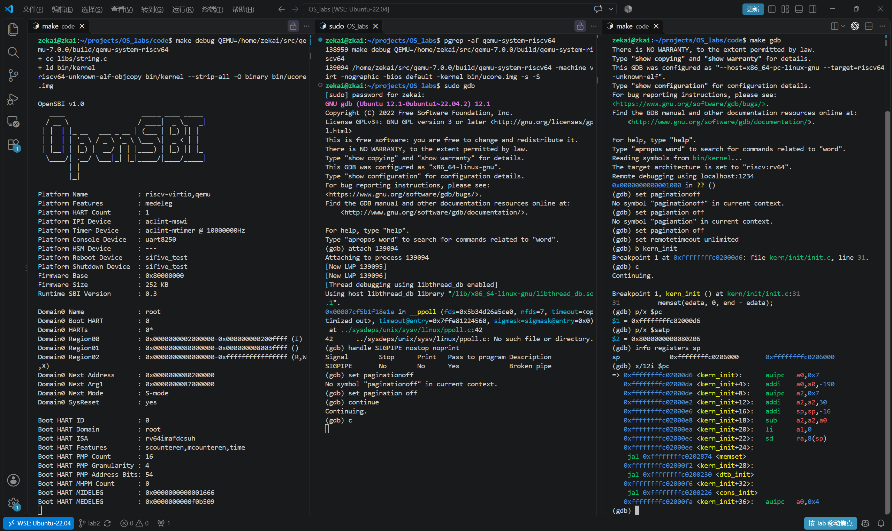

图4.3-1　三终端调试环境及内核入口处的执行状态。

#### 4.3.2 定位访存指令并确定目标地址

根据反汇编，目标指令位于 `0xffffffffc02000ec`。在终端③设置硬件辅助断点：

```gdb
hbreak *0xffffffffc02000ec
continue
x/i $pc
p/x $sp
p/x $sp+8
p/x $ra
```

内核停在 `sd ra,8(sp)` 执行之前。前面的 `addi sp,sp,-16` 已将栈指针调整为 `0xffffffffc0205ff0`，因此本次访存信息为：

| 项目 | 本次结果 |
| --- | --- |
| 指令 | `sd ra,8(sp)` |
| 指令地址 | `0xffffffffc02000ec` |
| 访问类型 | 写入 |
| 访问大小 | 8 字节 |
| 目标虚拟地址 | `0xffffffffc0205ff8` |
| 写入数据 | `ra = 0x8000966a` |

确定目标地址后，先在终端②设置下一小节中的 QEMU 条件断点并恢复 QEMU，再回到终端③输入：

```gdb
si
```

该命令要求客体执行一条机器指令。当 QEMU 在处理这次写访问时命中宿主机断点，终端③暂时等待，控制权转到终端②。

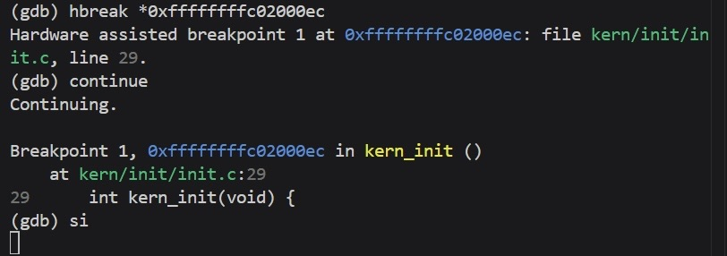

图4.3-2　内核停在目标访存指令处，并通过 `si` 发起本次写访问。

#### 4.3.3 捕捉 TLB 填充请求并进入地址翻译函数

在发出上述 `si` 之前，先在终端②按 `Ctrl+C` 暂停 QEMU，然后设置条件断点：

```gdb
break riscv_cpu_tlb_fill if address == 0xffffffffc0205ff8
break get_physical_address if addr == 0xffffffffc0205ff8 && is_debug == 0
continue
```

两个断点都限定目标虚拟地址，避免被大量无关访存打断；`is_debug == 0` 用于排除调试器读取内存时触发的调试地址翻译。

终端③执行 `si` 后，终端②首先停在 `riscv_cpu_tlb_fill`，其参数显示 `size = 8`、`access_type = MMU_DATA_STORE`、`mmu_idx = 1`，与所选 `sd` 的写访问一致。再执行一次 `continue`，程序进入 `get_physical_address`，随后查看：

```gdb
p/x addr
p/x env->satp
info args
```

得到 `addr = 0xffffffffc0205ff8`、`satp = 0x8000000000080206`，同时 `first_stage = true`、`two_stage = false`、`is_debug = false`，说明本次是正常客体访存的一阶段地址翻译。

从源码看，写访存处理路径先通过 `tlb_hit` 检查软件 TLB；未命中时还会查询 victim TLB，仍未命中才请求地址翻译与填充。本轮直接调试捕捉的是后续的 `riscv_cpu_tlb_fill` 和页表翻译入口，没有逐条单步展示前面的 TLB 命中判断。

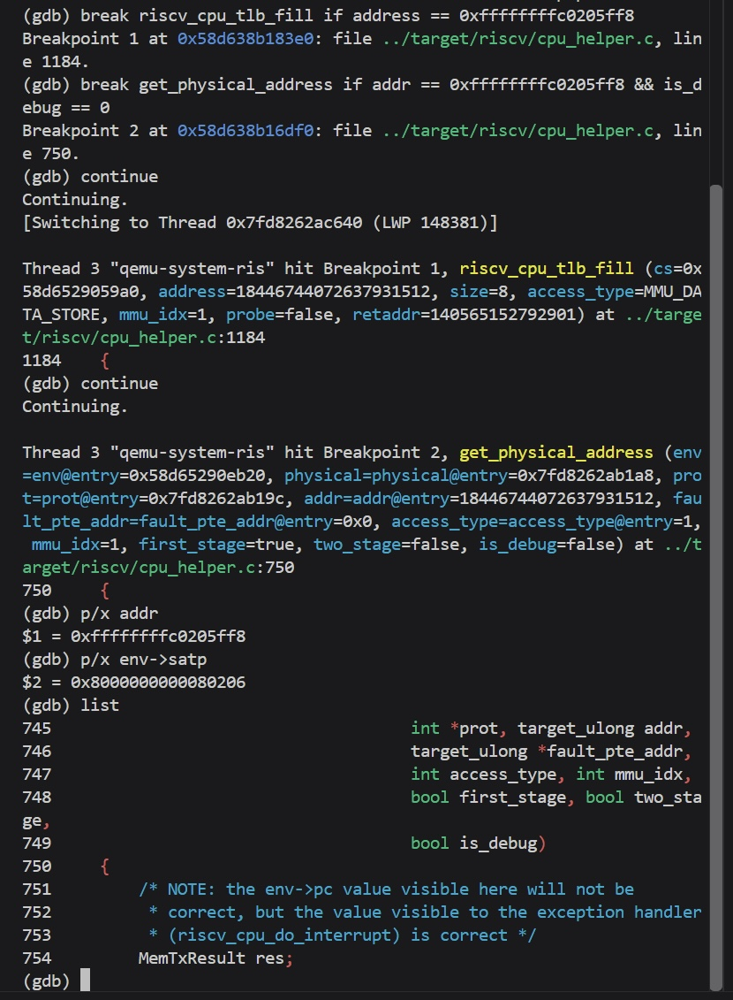

图4.3-3　目标写访问进入 `riscv_cpu_tlb_fill` 和 `get_physical_address`。

#### 4.3.4 读取根页表项

为了观察页表项的实际读取，在终端②设置临时断点：

```gdb
tbreak cpu_helper.c:923
continue
p/x base
p i
p levels
p/x idx
p ptesize
p/x pte_addr
```

程序停在以下语句之前：

```c
pte = address_space_ldq(cs->as, pte_addr, attrs, &res);
```

该语句从客体物理地址空间读取一个 8 字节页表项。停点处的实际结果如下：

| 变量 | 结果 | 分析 |
| --- | --- | --- |
| `base` | `0x80206000` | 由 `satp` 的 PPN 字段左移 12 位得到的根页表物理地址 |
| `i` | `0` | 第一次循环，正在查询 Sv39 根级页表 |
| `levels` | `3` | 当前分页模式最多包含三级页表 |
| `idx` | `0x1ff` | 根级索引为 511 |
| `ptesize` | `8` | 每个页表项占 8 字节 |
| `pte_addr` | `0x80206ff8` | 本次将要读取的页表项物理地址 |

这与以下计算一致：

```text
根页表地址 = 0x80206 << 12 = 0x80206000
根级索引   = (0xffffffffc0205ff8 >> 30) & 0x1ff = 511
页表项地址 = 0x80206000 + 511 × 8 = 0x80206ff8
```

随后执行一次读取：

```gdb
next
p/x pte
p res
```

得到 `pte = 0x200000cf`、`res = 0`，其中 `res = 0` 对应 `MEMTX_OK`，表明页表项读取成功。

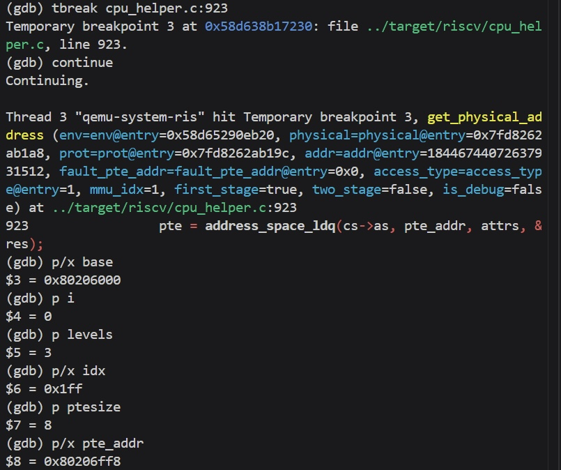

图4.3-4　QEMU 在读取页表项前的索引计算结果。

#### 4.3.5 判断叶子项并组合物理地址

读取页表项后，QEMU 会依次检查有效位、权限组合、访问特权、大页对齐以及本次访问所需的权限。通过以下命令查看相关判断，并停在合法叶子项的处理分支：

```gdb
list 935,985
tbreak cpu_helper.c:981
continue
p/x ppn
p ptshift
p mode
p access_type
p/x pte
```

得到 `ppn = 0x80000`、`ptshift = 18`、`access_type = 1`、`pte = 0x200000cf`。其中 `mode` 显示为 `<optimized out>`，表示编译优化使 GDB 无法恢复该局部变量，并不表示页表翻译失败。

页表项可以拆解为：

```text
PPN = pte >> 10 = 0x80000
低 8 位 = 0xcf，即 V、R、W、X、A、D 为 1，U 为 0
```

`V = 1` 表示页表项有效，R/W/X 非零表示这是叶子项，W 为 1 允许本次写访问。该叶子项位于根级，因此本次使用的是 1 GiB 大页，不需要再读取下两级页表。`ptshift = 18` 对应被大页覆盖的低级 VPN 位数，加上 12 位页内偏移，共有 30 位大页内偏移，即映射范围为 `2^30` 字节。A、D 位已经置位，本次也无需修改页表项中的访问位和脏位。

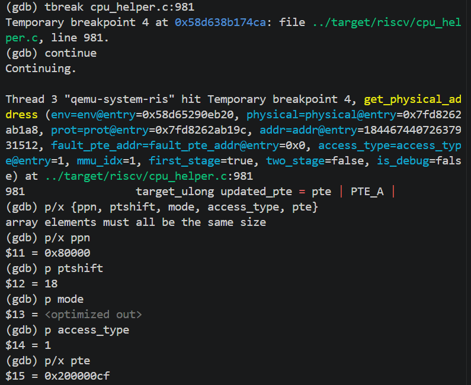

图4.3-5　通过页表项检查后，读取 PPN、`ptshift` 和访问类型。

接着停在物理地址组合位置，并单步执行：

```gdb
tbreak cpu_helper.c:1033
continue
p/x ppn
p/x vpn
p/x napot_mask
p ptshift
p/x addr
next
p/x *physical
```

实际读取到 `*physical = 0x80205ff8`。这里 `physical` 是输出参数指针，解引用后的 `*physical` 才是最终客体物理地址。本次组合可以表示为：

```text
大页物理基址 = 0x80000 << 12 = 0x80000000
大页内偏移   = 0xffffffffc0205ff8 & 0x3fffffff = 0x205ff8
物理地址     = 0x80000000 + 0x205ff8 = 0x80205ff8
```

这说明根级叶子项提供大页物理基址，而虚拟地址的低 30 位保留为大页内偏移，二者共同确定实际访问位置。

#### 4.3.6 观察软件 TLB 填充

完成物理地址组合后，在终端②执行：

```gdb
finish
p/x pa
p/x prot
tbreak tlb_set_page if vaddr == 0xffffffffc0205000
continue
info args
```

`finish` 执行完 `get_physical_address` 后返回 `riscv_cpu_tlb_fill`。本次翻译函数返回 0，得到 `pa = 0x80205ff8`、`prot = 0x7`，即允许读、写、执行。随后 QEMU 进行物理内存保护检查，并进入 TLB 填充路径。

继续进入实际构造 TLB 表项的函数：

```gdb
tbreak tlb_set_page_with_attrs
continue
p/x vaddr
p/x paddr
p size
```

结果为：

```text
vaddr   = 0xffffffffc0205000
paddr   = 0x80205000
size    = 4096
prot    = 7
mmu_idx = 1
```

这两个地址分别是目标虚拟地址和物理地址按 4 KiB 对齐后的页起始地址，加上页内偏移 `0xff8` 就能还原本次访问地址。

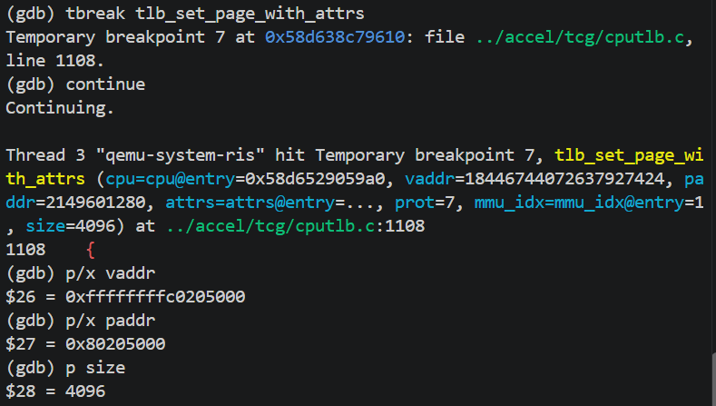

图4.3-6　`tlb_set_page_with_attrs` 中的虚拟页地址、物理页地址和映射大小。

为了进一步观察填充路径，执行：

```gdb
list 1185,1260
tbreak cputlb.c:1243
continue
p/x address
list 1260,1275
tbreak cputlb.c:1270
continue
```

源码显示，该函数先计算 TLB 索引并取得目标槽位，必要时将旧映射移入 victim TLB；然后设置新表项中的 `addend`、`addr_read`、`addr_code` 和 `addr_write`，最终通过 `copy_tlb_helper_locked(te, &tn)` 将新表项复制到目标位置。

其中，读写和取指地址字段保存客体虚拟页地址及状态标志，`addend` 用于将客体虚拟地址转换为宿主机内存地址，不能将其直接当成客体物理地址。受编译优化和内联影响，部分局部变量不可直接读取；本次确认了填充参数及相应代码路径，没有逐项直接验证最终驻留表项的所有字段。

#### 4.3.7 验证访存指令的最终执行结果

完成 QEMU 填充路径的观察后，在终端②输入：

```gdb
continue
```

QEMU 恢复执行后，终端③等待中的 `si` 完成。随后在终端③查看当前指令和目标内存：

```gdb
x/i $pc
x/gx 0xffffffffc0205ff8
```

实际结果如下：

```text
PC = 0xffffffffc02000ee
当前指令：jal 0xffffffffc0202874 <memset>
0xffffffffc0205ff8: 0x000000008000966a
```

PC 已从 `sd` 所在的 `0xffffffffc02000ec` 移到下一条指令，说明本次写操作已经执行结束。目标内存中的 8 字节值为 `0x000000008000966a`，与执行前 `ra` 的值一致，验证了保存返回地址的操作成功完成。

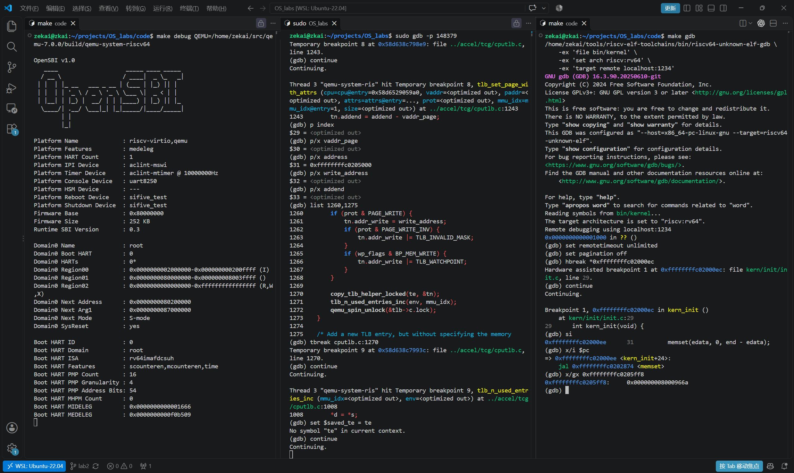

图4.3-7　恢复 QEMU 后，目标访存指令执行完成，写入内容与预期一致。

本次调试将客体指令与模拟器内部的处理过程对应起来：`sd ra,8(sp)` 访问虚拟地址 `0xffffffffc0205ff8`，QEMU 读取根页表第 511 项，识别出 1 GiB 大页叶子映射，将其翻译为物理地址 `0x80205ff8`，再进入软件 TLB 填充并完成写入。实验说明，Sv39 的三级结构并不意味着每次都需要访问三级页表，遇到高层级叶子项即可提前结束遍历。同时，QEMU 通过软件数据结构和宿主机代码实现地址转换与缓存管理，观察这些实现时，需要区分客体虚拟地址、客体物理地址与宿主机内存地址。

---

## 五、测试与验证

### 5.1 Page_init 和 Best-Fit 的测试验证

**成员：** 2412414-黄子恒，2411268-黄泽恺

Page_init 和 Best-Fit 的编译和运行在 WSL Ubuntu-24.04 中完成，使用 RISC-V GCC 13.2.0、QEMU 8.2.2 和 OpenSBI v1.3。按照实验要求，将物理内存管理器选择为 Best-Fit，保留 `basic_check()` 和 `best_fit_check()`，通过实际启动内核检查分配器是否正确接入并通过自检。

在工程的 `code/` 目录执行：

```bash
make -j2 PMM=best_fit
make qemu PMM=best_fit
```

工程编译、链接成功，QEMU 能够进入 ucore 内核。设备树解析得到默认的 128 MiB 物理内存，范围为 `[0x80000000, 0x88000000)`。启动输出中确认当前管理器为 `best_fit_pmm_manager`，随后出现：

```text
check_alloc_page() succeeded!
[Best-Fit extra] selection, split, ties and failures: PASS
[Best-Fit extra] insertion, merging, registration and cycles: PASS
[Best-Fit extra] live free-page count restored: PASS
```

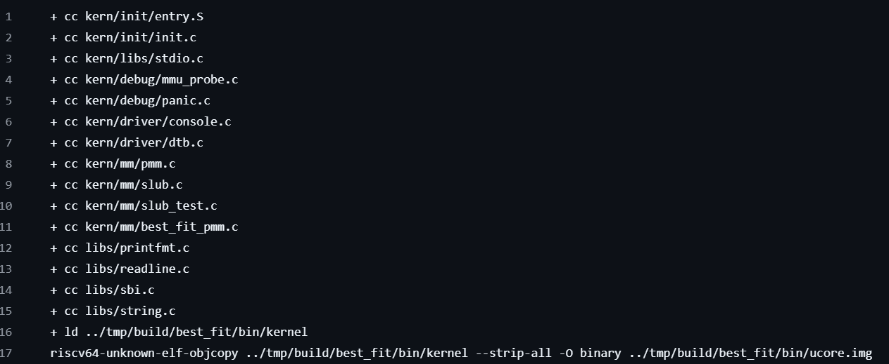

**原有测试。** 我们运行框架为我们提供的测试脚本，在工程的 `code/` 目录执行：

```bash
make grade
```

结果如图所示：

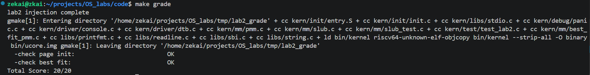

**补充测试。** 为验证原有测试未充分覆盖的行为，先申请连续 32 页作为独立测试区域，暂存其余空闲资源，再构造以下布局。表中偏移相对于测试区首页，所有检查均通过断言完成。

| 测试内容 | 操作与预期结果 | 实际结果 |
|---|---|---|
| 非精确最佳适配 | 按地址排列 8、5、7 页三个块，申请 4 页，应选择 5 页块并留下 1 页 | 通过，未误选第一个合适块 |
| 精确匹配与同大小候选 | 分配恰好满足请求的块；多个最小候选大小相同时选择低地址块 | 通过，整块分配后首页退出空闲链表 |
| 拆分后的剩余块 | 5 页块申请 3 页，剩余 2 页的首页、长度和链表位置应正确 | 通过 |
| 两种分配失败 | 总量不足，或总量足够但最大连续块不足，均应返回 NULL | 通过，失败前后链表和空闲页数保持一致 |
| 插入和回收合并 | 覆盖空表、头部、中间、尾部插入，以及无合并、仅向前、仅向后和双向合并 | 通过，旧首页标志清除，合并不重复增加页数 |
| 空闲区注册 | 将 6 页置为保留状态，分段逆序注册并合并 | 通过，保留状态解除，引用计数归零，最终形成 6 页块 |
| 重复分配与资源恢复 | 连续 32 页反复分配 3 页、5 页并回收，执行 16 轮 | 通过，每轮恢复完整块；测试结束后真实空闲页总数恢复 |

`best_test_state()` 还检查双向链表关系、地址顺序、块不重叠、首页标志和空闲总数。测试完成后恢复原空闲链表并归还全部测试页，避免测试影响后续内核运行。

为检查补充测试是否有效，在独立副本中把策略改为“优先精确匹配，否则选择第一个合适块”。该错误实现能通过原有自检，却在 8、5、7 页块中申请 4 页的用例上触发断言，说明新增测试能够识别不完整的 Best-Fit 实现，详见下图。

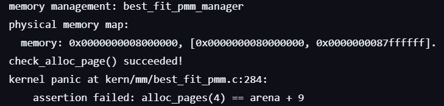

### 5.2 Buddy System／SLUB 自定义测试与边界验证

完成的自定义测试对应 4.2.3 和 4.2.4，使用 `python3 code/tools/check_member_c.py` 执行宿主及 QEMU 检查。宿主测试链接实际 Buddy、SLUB 源码，启用 ASan/UBSan；内核测试通过启动流程调用管理器与对象层自检。

| 测试项目 | 实际结果 |
|---|---|
| Buddy 非对齐初始化、取整、拆分与递归合并 | 通过；93 页区间无页面丢失，各请求容量扣减及回收正确 |
| Buddy 碎片、区间空洞与混合分配 | 通过；非伙伴不能合并，4000 次操作保持区间不重叠和页数守恒 |
| Buddy 最大阶与超大请求 | 通过；最大阶分配可恢复，越界请求返回 NULL |
| SLUB 尺寸边界、对齐与内容 | 通过；30 种尺寸的对象区间不重叠，写入内容保持完整 |
| SLUB 多 slab、槽位复用与空页回收 | 通过；300 个小对象及 3000 次混合分配后页数恢复 |
| SLUB 底层内存耗尽与恢复 | 通过；小、大对象申请失败后状态保持正确，归还页面后恢复分配 |
| Buddy／SLUB 非法释放 | 7 个独立用例均触发预期断言，以退出码 77 及对应断言判定正确拒绝 |
| QEMU 内核自检 | Buddy 在 32、128、256 MiB 配置通过；SLUB 同时在 First-Fit 的 128 MiB 配置通过 |

上述多内存配置使用 QEMU 10.2.1；另在 QEMU 4.1.1 的 128 MiB 配置完成 Buddy 与 SLUB 内核检查。256 MiB 是 QEMU 提供的 RAM 容量，当前框架可管理的物理上界仍为 `0x88000000`，不能据此认为分配器使用了全部 256 MiB。

宿主与异常用例结果分别保存在 `report/evidence/host-tests.log` 和 `report/evidence/invalid-free-tests.log`；内核日志为 `report/evidence/qemu-buddy-32M.log`、`qemu-buddy-128M.log`、`qemu-buddy-256M.log`、`qemu-default-128M.log`，QEMU 4.1.1 日志为 `report/evidence/qemu41/qemu-buddy-128M.log`。

### 5.3 实现与验证过程中遇到的问题

| 问题 | 原因分析 | 处理与验证 |
|---|---|---|
| Best-Fit 补充测试需要与其他分配器共存 | 各分配器按 `PMM` 参数分别编译，Buddy 构建不会链接 Best-Fit 专用函数 | 补充测试入口仅在 `PMM_BEST_FIT` 下调用；Best-Fit 与 Buddy 均能独立编译和运行 |
| 辅助评分显示 0/20，但稍后内核日志已有 PASS | 原脚本固定等待约 1 秒，Windows 挂载目录中的串口日志尚未写完；并发读取时还出现过 `No data available` | 排查时对比不同临时目录下的输出时机；最终保留原有两项 PASS 判据，等待测试结果或超时后再判分，并清理本次启动的 QEMU 子进程；评分副本位于仓库 `tmp/` 目录 |

---

## 六、实验总结与收获

### 6.1 实验知识点与操作系统原理的联系

基于 First-Fit、Best-Fit 与接入验证的总结。

| 实验知识点及其含义 | 对应 OS 原理知识点及其含义 | 二者的联系 | 实现中的差异或简化 |
|---|---|---|---|
| Page 描述符、首页标志和块长度 | 物理内存的元数据与资源状态管理 | 分配器必须区分真实页面与描述它的管理结构，避免把保留页当作空闲页 | 元数据采用固定描述符数组，当前面向连续 DRAM 范围 |
| First-Fit 与 Best-Fit 的候选选择 | 连续空间动态分配策略与外部碎片 | 同一空闲集合可因选择策略不同产生不同剩余布局；总空闲量不等于最大可分配连续量 | 按 4 KiB 整页分配，未实现一般字节级分区管理 |
| 拆分与前后合并 | 空闲空间回收和合并 | 拆分满足当前请求，合并恢复较大连续区间，合并不增加实际资源总量 | 依赖地址有序链表和合法释放契约，没有完整历史追踪 |
| pmm_manager 函数指针 | 机制与策略分离 | 页面探测和公共接口复用，不同策略通过回调接入 | 当前编译期选择管理器，不支持运行中迁移已有分配 |
| Sv39 启动映射与地址转换 | 虚拟地址、物理地址及分页翻译 | Page 指针是管理结构地址，分配的对象是物理页；开启分页还需保证下一条指令可访问 | 启动页表主要使用大页映射，未亲自实现完整多级页表遍历 |
| 保持计数、标志和链表一致 | 系统资源不变量 | 正确性不仅是返回非 NULL，还包括无重叠、失败不改变状态和回收后守恒 | 用断言和确定性用例验证，尚无并发证明 |

### 6.2 本实验尚未涉及的重要 OS 知识点

| 知识点 | 核心含义 | 重要性 | 与本实验范围的区别 |
|---|---|---|---|
| 进程地址空间和缺页处理 | 为进程建立独立映射，并处理访问未驻留页面的异常 | 支撑隔离、按需使用内存 | 在单一内核初始化路径分配物理页，没有实现用户进程缺页流程 |
| 页面置换与交换 | 物理内存不足时选择页面换出并在需要时调入 | 支撑超出 RAM 的工作集 | 本任务资源不足返回 NULL，没有实现换出和磁盘交换 |
| 多核并发分配与 TLB 一致性 | 协调并发修改及不同 CPU 的翻译缓存 | 防止数据竞争和旧映射访问 | 本实现依赖单核初始化调用，不提供分配器锁或跨核刷新协议 |
| 写时复制和共享页生命周期 | 共享页面并在写入时复制，结合引用计数管理归属 | 提高进程创建及共享效率 | 框架有 ref 字段，但仅初始化和检查它，没有实现完整共享页协议 |


### 6.3 实验收获

1. 本次实验使我们对物理内存管理与分页机制建立了更加具体的认识。通过学习 Sv39 地址转换过程，我们理解了虚拟地址中的虚拟页号与页内偏移、页表项中的物理页号与权限标志，以及 TLB 对地址转换的加速作用。同时，我们区分了物理页、页表项和 `Page` 描述符：物理页提供实际存储空间，页表项描述地址映射与访问权限，而 `Page` 描述符记录物理页的管理状态。在此基础上，通过分析 First-Fit、Best-Fit 和 Buddy System 的设计，我们进一步认识到不同分配策略在查找开销、连续空间利用和内存碎片方面存在不同取舍。

2. 我们加深了对“将内存管理原理转化为代码”的理解。以 `page_init()` 为例，初始化过程不仅需要读取设备树提供的内存范围，还需要区分虚拟地址、物理地址和物理页号，计算描述符数组的位置，并通过页对齐排除不能分配的区域。先将所有页面标记为保留，再把确认可用的完整页面交给分配器，使我们理解了如何避免覆盖 OpenSBI、内核镜像和管理数据。此外，通过阅读空闲链表的插入、分割与合并代码，我们掌握了利用嵌入式链表组织空闲块的方法，也认识到链表相邻并不意味着物理地址连续，合并操作必须检查实际的地址关系。

3. 在 GDB 调试方面，我们学习了从内核和模拟器两个层面观察系统运行的方法。RISC-V GDB 用于控制 ucore 内核的执行、查看指令和寄存器；宿主机 GDB 则用于调试 QEMU，观察模拟器如何完成地址转换。结合断点、条件断点和单步执行，可以将虚拟地址、页表索引、页表项和最终物理地址联系起来。这一过程帮助我们将抽象的分页原理与具体代码对应起来，也使我们认识到调试前应先明确观察目标和预期结果，再根据实际执行路径分析问题。

### 6.4 AI 辅助学习与开发的经验

1. 本次实验中，我们逐步学会了按照实验要求撰写四段式提示词，将原本笼统的需求整理为结构清晰、可以检查的任务说明。撰写提示词时，需要交代现有代码背景，明确需要完成的功能，说明接口、边界条件及实现约束，并给出输出和验收要求。例如，在实现物理内存初始化时，不能只要求 AI“补全函数”，还应说明地址转换关系、描述符数组布局、保留区域和页面对齐要求。这个过程也促使我们先理解任务，再向 AI 提出需求。

2. 实验过程中，我们也遇到了由于没有明确限定 AI 工作区和修改范围，导致无关文件被误改的问题。这说明，仅说明“要实现什么功能”还不够，还需要说明“在哪个目录、哪些文件中完成”。当工作区存在多个实验目录或相似代码时，如果缺少明确限制，AI 可能根据错误的上下文修改其他文件，增加检查和恢复的成本。
针对这一问题，我们认识到，应在提示词中写明项目根目录、允许修改的文件和函数，并明确禁止修改原有测试及无关实验代码。对于新增文件或跨文件修改，应要求 AI 先说明必要性；完成修改后，应检查实际变更与任务要求是否一致，并利用版本管理保留可追溯的记录。工作区边界与文件修改范围应成为提示词约束的重要组成部分。
此外，AI 更适合作为解释代码、梳理思路和辅助排错的工具。对于生成的代码，我们仍需要理解关键变量的含义、检查边界条件，并通过编译、测试和调试确认其行为。遇到问题时，提供具体代码、报错信息、预期结果和实际结果，比简单描述“运行失败”更有助于定位原因。通过这种协作方式，我们不仅提高了完成实验的效率，也锻炼了需求表达、代码审查和独立验证的能力。
