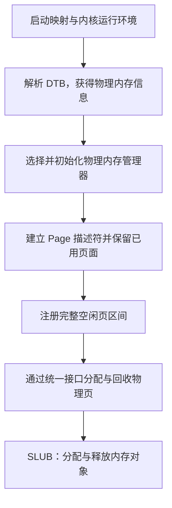

# 操作系统实验报告

## 实验基本信息

| 项目 | 内容 |
|------|------|
| **实验名称** | Lab 2: 物理内存和页表 |
| **小组成员** | 2411268-黄泽恺、2412414-黄子恒、2412677-郑奕杰 |
| **完成日期** | YYYY-MM-DD |

### 小组分工

#### 练习分工

| 成员 | 负责的练习/模块 |
|------|----------------|
| 2411268-黄泽恺 | 功能模块一：物理内存初始化功能 |
| 2412414-黄子恒 | [练习或模块名称] |
| 2412677-郑奕杰 | [练习或模块名称] |

#### 实验报告分工

| 成员 | 负责的章节 |
|---|---|
| 2411268-黄泽恺 | 3.1 本章节的逻辑主线；3.2.1—3.2.3；4.1 功能模块一（含 Challenge） |
| 2412414-黄子恒 | 待填写 |
| 2412677-郑奕杰 | 待填写 |

---

## 一、实验目的

本实验的主要目的是：

1. 理解页表的建立和使用方法
2. 理解物理内存的管理方法
3. 理解页面分配算法

---

## 二、实验环境

WSL: Ubuntu-22.04

| 成员 | AI 编程工具 | 底层模型 | 备注 |
|------|------------|---------|------|
| 2411268-黄泽恺 | ChatGPT Work | GPT-6.1 Sol | - |
| 2412414-黄子恒 | ChatGPT Work | GPT-6.1 Sol | - |
| 2412677-郑奕杰 | ChatGPT Work | GPT-6.1 Sol | - |

**说明：**

- **AI 编程工具**：指具体使用的终端工具、编辑器插件、桌面应用或浏览器界面
- **底层模型**：指该工具使用的大语言模型及版本

---

## 三、实验整体逻辑分析

### 3.1 本章节的逻辑主线

本章节围绕“让内核能够发现、组织并分配物理内存”展开。在 Lab1 已经建立最小内核、能够进入 C 初始化函数并输出信息的基础上，Lab2 进一步处理内存从哪里获取、哪些页面可以使用、如何按需分配与回收等问题。页表内容为内核访问内存提供地址映射背景，物理内存管理则负责记录各页的状态和分配情况，两者共同支撑内核对内存的使用。

首先，内核需要接收并解析启动阶段传入的设备树信息，获得实际 RAM 的起始地址与大小；随后选择物理内存管理器，初始化其内部状态，再由 `page_init()` 建立页面描述符数组，保留 OpenSBI、内核镜像和管理结构所占页面，将剩余的完整页面注册为空闲区。完成这些步骤后，页面分配与回收接口才具有明确的管理对象和初始状态。

后续任务在统一的物理内存管理框架中，先分析已有 First-Fit 的空闲块组织、分配和回收流程，再实现并接入 Best-Fit，进一步自行设计 Buddy System 及其测试；SLUB 扩展则在页级分配的基础上处理不同大小的内存对象。内核运行时使用当前选定的分配器，各算法通过共同接口接入，使内存发现与初始化过程能够和具体分配策略衔接。



设备树提供内存范围，描述符记录物理页状态，空闲区注册建立可分配资源，分配算法决定如何使用和回收这些资源，而运行检查与配套测试用于验证各阶段的衔接与状态变化。

### 3.2 功能的逐步实现

> 填写约定：下面各阶段分别说明“解决什么问题、依赖哪些前置条件、为后续提供什么能力、为什么按这个顺序安排”。尚未填写的阶段保留提示，后续按实际任务补充。

#### 3.2.1 启动准备：启动映射、内核运行环境与 DTB 信息获取

本章的初始化建立在框架已有的启动代码之上。`entry.S` 中的 `kern_entry` 首先保存启动参数：将 `a0` 中的硬件线程编号写入 `boot_hartid`，将 `a1` 中的 DTB 物理地址写入 `boot_dtb`。设备树地址通过启动约定传递，使内核可以在尚未建立动态内存管理能力时找到硬件描述信息。

内核链接脚本将虚拟布局起点设置为 `0xFFFFFFFFC0200000`，对应当前平台上的内核物理起点 `0x80200000`，两者相差 `PHYSICAL_MEMORY_OFFSET = 0xFFFFFFFF40000000`。入口汇编提供 Sv39 启动根页表，其最后一个页表项用作 1 GiB 叶映射，覆盖内核使用的高地址区域；启动代码把根页表的物理页号与 Sv39 模式编码写入 `satp`，刷新地址转换缓存，并准备内核栈和高地址 C 入口。

进入 `kern_init()` 后，程序先对 `[edata, end)` 所指示的 BSS 区域清零，再调用 `dtb_init()`。这一顺序既满足未显式初始化的全局变量和静态变量应为零的要求，也使解析后保存的内存信息不会被后续 BSS 清零覆盖。`dtb_init()` 使用固定映射偏移访问 DTB，检查地址和魔数，再由 `extract_memory_info()` 查找内存节点的 `reg` 属性，将解析出的起点和长度保存为 `memory_base` 与 `memory_size`。

#### 3.2.2 物理内存管理框架初始化与管理器选择

获得内存信息后，`kern_init()` 调用 `pmm_init()` 进入物理内存管理初始化阶段。`pmm_init()` 首先调用 `init_pmm_manager()` 选定管理器并执行其初始化接口，然后调用 `page_init()` 建立页面描述与初始空闲区，之后通过 `check_alloc_page()` 调用该管理器的自检函数。这样的顺序保证空闲页被注册时，管理器内部的链表、计数等结构已经处于可用状态。

`struct pmm_manager` 使用函数指针统一描述不同物理内存分配器的能力，包括 `init`、`init_memmap`、`alloc_pages`、`free_pages`、`nr_free_pages` 和 `check`。对外的 `alloc_pages()`、`free_pages()` 等函数通过全局指针 `pmm_manager` 转发请求。

默认的 `pmm_manager = &default_pmm_manager`，使用已有 First-Fit 管理器。它的 `init` 接口初始化空闲链表头并将空闲页计数设为零，这时尚未把物理页面交给分配器。随后 `page_init()` 计算出可以使用的区间，再通过 `init_memmap()` 包装函数调用当前管理器的同名接口完成注册。

管理器初始化和空闲区注册承担不同职责：前者建立分配器的数据结构，后者把经过内存布局检查的具体页面纳入管理。将这两个步骤分开，有助于复用相同的内存探测与描述符初始化逻辑，也使后续算法能够在统一的页面表示上工作。

#### 3.2.3 物理内存探测、Page 描述符初始化与空闲页注册

`page_init()` 连接设备树解析结果和页面分配器。它读取实际 RAM 的起点与大小，检查范围是否符合当前平台约定、长度是否有效以及地址相加是否溢出，再结合内核支持的物理上界确定可管理的完整页面范围。由于后续布局计算会使用 `PADDR()`，函数需要先将 `va_pa_offset` 设置为启动映射所使用的固定偏移。

确定范围后，函数在内核结束符号 `end` 之后按页对齐安排连续的 `Page` 描述符数组，用其中的每个元素记录一个物理页的状态。数组覆盖的物理页号区间为 `[nbase, npage)`，因此元素个数是 `npage - nbase`。描述符数组也占用 RAM，必须连同 OpenSBI、内核镜像以及对齐产生的间隙一起排除在空闲区之外。

建立初始状态时，所有描述符先设为保留。函数再将描述符数组结束位置换算为物理地址并向上按页对齐，将可管理末端向下按页对齐；若中间仍有完整页面，就通过 `pa2page()` 定位起始描述符，交由 `init_memmap()` 注册。当前 First-Fit 管理器在注册过程中清除这些页面的保留状态、建立空闲块属性并更新空闲页计数，其余已占用页面继续保留。

因此，物理页分配必须安排在该阶段之后：分配器既需要知道页面对应的描述符，也需要一个已经排除占用空间的初始空闲集合。内存范围检查、元数据布局和页面状态初始化共同保证后续分配不会覆盖仍在使用的内核及管理结构。

#### 3.2.4 理解 First-Fit 连续物理内存分配与回收流程

> 填写：说明阅读现有 First-Fit 实现的目标，以及空闲区初始化、连续页分配、释放与合并在后续算法实现中的参考作用。

#### 3.2.5 实现并接入 Best-Fit 连续物理内存分配器

> 填写：说明从已有分配框架过渡到 Best-Fit 实现的任务安排，以及完成模块实现、管理器切换与正确性检查之间的关系。

#### 3.2.6 实现并验证 Buddy System 分配器

> 填写：说明伙伴系统任务在本章中的位置，以及自行设计分配模块、接入接口和配套测试的先后关系。

#### 3.2.7 扩展任意大小内存单元的 SLUB 分配（选做）

> 填写：说明该扩展与页级分配功能的关系，以及对象分配模块和相应测试的任务安排；按实际完成情况描述。

#### 3.2.8 编译运行与整体正确性验证

> 填写：说明如何把各阶段的实现与检查串联起来，以及局部验证和整体运行各自需要确认什么。实际命令、结果和证据放在第五章。

---

## 四、实验内容与实现

> 填写约定：各任务按“模块功能描述”和“最终提示词”组织，不单独撰写 Spec 设计。模块功能描述中列出实际需要实现或修改的函数签名，并说明系统作用、主要场景及模块交互；编程任务的最终提示词保留实际采用的四段式内容，思考题记录实际提问。
>
> 思考题无需编写函数，在功能说明中回答问题；如未使用 AI，最终提示词标注“不适用”。Bug、修复过程和实际验证结果统一记录在第五章。尚未填写的部分保留提示，不代表已经完成或通过验证。

### 4.1 功能模块一：物理内存初始化功能

#### 4.1.1 任务一：实现物理内存探测与页描述符初始化功能

**负责人：** 2411268-黄泽恺

**需要实现/修改的函数：**

```c
static void page_init(void);
```

**功能说明：**

`page_init()` 位于物理内存管理初始化阶段，不接收参数也不返回结果，通过设置 `va_pa_offset`、`npage` 和 `pages`，以及向当前管理器注册空闲页来完成工作。它根据设备树提供的信息确定可管理范围，建立页面状态记录，并划定能够进入分配器的初始空闲区。`get_memory_base()`、`get_memory_size()`、`PADDR()`、`pa2page()` 和 `init_memmap()` 等均为已有依赖，本任务补全的接口是 `page_init()`。

**1. 内存范围检查与地址转换。**

函数首先读取设备树解析结果，设置 `va_pa_offset = PHYSICAL_MEMORY_OFFSET`。当前实现要求内存起点等于平台的 `DRAM_BASE`，并检查内存长度非零及 `mem_base + mem_size` 没有发生无符号溢出；无效时调用 `panic()` 终止初始化。输出的最后一个字节地址为 `mem_end - 1`，后续区间计算则使用排他末端 `mem_end`。

可管理物理上界 `maxpa` 取实际内存末端与 `PHYSICAL_MEMORY_END` 的较小值，再向下按 `PGSIZE` 对齐。这样既遵守内核支持的范围，也排除末尾不足一页的部分。函数还将内核结束位置转换为物理地址，检查内存是否足以容纳内核。默认内存布局中的 RAM 为 `[0x80000000, 0x88000000)`，其中 `[0x80000000, 0x80200000)` 按本实验布局为 OpenSBI 保留，内核镜像从 `0x80200000` 开始。

**2. Page 描述符与物理页的对应。**

`Page` 保存引用计数 `ref`、状态标记 `flags`、空闲块长度 `property` 和链表关系 `page_link`。描述符连续组成数组，其地址与它所描述的物理页地址分别计算：

| 变量或关系 | 在本模块中的含义 |
|---|---|
| `nbase = DRAM_BASE / PGSIZE` | DRAM 起始物理页号 |
| `npage = PPN(maxpa)` | 可管理物理页号的排他上界 |
| `pages` | 描述符数组的内核虚拟地址 |
| `npage - nbase` | 描述符数组的元素个数 |
| `pages[i]` 对应 `(nbase + i) * PGSIZE` | 第 `i` 个描述符所记录的物理页起始地址 |

例如，对于上述默认的 128 MiB RAM，`nbase = 0x80000`，`npage = 0x88000`，描述符数量为 `0x8000`，即 32768 个。该数量包含需要保留的 DRAM 页面，所以还需要继续标记哪些页面已经被占用。

**3. 描述符数组布局与容量保护。**

链接符号 `end` 是内核镜像结束位置的虚拟地址。函数将其向上按页对齐作为 `pages`，数组所需字节数为 `(npage - nbase) * sizeof(struct Page)`。写入任何描述符之前，先检查数组起点及其完整大小是否落在可管理内存内；容量判断使用剩余空间除以结构体大小的方式，避免先做不受约束的乘法。无法容纳描述符时调用 `panic()`。

当前布局可概括为：

```text
DRAM 起点                                                     可管理末端
   |                                                              |
   [ OpenSBI ][ 内核镜像 ][ 对齐空隙 ][ Page 数组 ][ 对齐空隙 ][ 空闲整页 ]
              内核起点      end 之后       数组自身也占用物理内存
```

数组容量确认后，函数逐个将描述符的 `flags`、`property` 和引用计数初始化，再设置保留标记。这样在明确注册空闲区以前，所有页面都具有保留状态，内核、描述符数组及相关间隙所在页面不会被提前分配。

**4. 空闲区注册与管理器交互。**

函数将描述符数组的物理结束位置向上按页对齐，得到 `freemem`。只有 `freemem < maxpa` 时，才调用 `init_memmap(pa2page(freemem), (maxpa - freemem) / PGSIZE)`。通过这一条件，注册的页数始终为正，不会出现零页注册或区间相减下溢。

`init_memmap()` 将起始描述符和页数转发给当前 `pmm_manager`。当前 First-Fit 实现在确认页面原为保留状态后，清除相应标记和计数，设置空闲块首页的 `property` 与 `PG_property`，加入空闲链表并累加空闲页数。内存范围与占用布局由 `page_init()` 确定，空闲数据结构由管理器维护。

当描述符数组能够容纳但其后没有完整空闲页时，`page_init()` 跳过空闲区注册。这个分支保证本函数不会错误注册页面；后续分配器自检是否能够继续，还取决于它所需的可用页数。当前实现针对单段连续 RAM，且没有为原始 DTB 单独保留页面；这是在内存起点和长度已保存、当前后续流程不再读取原始 DTB 的前提下采用的处理方式。

**最终提示词**

以下是经过迭代优化后，最终成功实现该功能的提示词：

````markdown
[PROMPT]

**任务**：完成 ucore Lab2“功能模块一：物理内存初始化功能”的任务一，在 `/home/zekai/projects/OS_labs/code/kern/mm/pmm.c` 中实现 `static void page_init(void)`，根据设备树提供的物理内存信息建立 Page 描述符数组，并将排除 OpenSBI、内核镜像及描述符数组占用空间后的完整空闲页面交给当前物理内存管理器。

**操作要求**：必须修改项目中的实际文件，在 `//lab2 function1 YOUR CODE` 标记处补全函数。保留已有代码和接口，本次修改限于该任务，不修改内存分配算法或切换 `pmm_manager`。

**输出要求**：依据下面的上下文、接口清单和行为规格完成实现，以项目真实代码为准。完成后简要说明内存布局、边界处理及实际执行的验证结果；无法执行的验证应明确说明。

[RELY]

**1. 初始化流程**

`kern_init()` 已在调用 `pmm_init()` 前执行 `dtb_init()`，解析并保存设备树中的内存信息。`pmm_init()` 先调用 `init_pmm_manager()` 初始化当前管理器，再调用待实现的 `page_init()`，随后执行已有的分配器检查。

**2. 已有宏定义**

以下定义已存在于工程中，直接使用，不要重复定义：

```c
#define DRAM_BASE               0x80000000
#define PGSIZE                  4096
#define PGSHIFT                 12
#define PPN(la)                 (((uintptr_t)(la)) >> PGSHIFT)

#define KERNBASE                0xFFFFFFFFC0200000
#define PHYSICAL_MEMORY_END     0x88000000
#define PHYSICAL_MEMORY_OFFSET  0xFFFFFFFF40000000
#define KERNEL_BEGIN_PADDR      0x80200000
```

工程还提供：

- `ROUNDUP(a, n)`、`ROUNDDOWN(a, n)`：向上、向下对齐。
- `PADDR(kva)`：将内核虚拟地址转换为物理地址，转换依赖 `va_pa_offset`，必须先正确设置该变量。
- `SetPageReserved(page)`、`PageReserved(page)`：设置、检查页面的保留状态。
- `panic(...)`：报告错误并终止执行。

当前工程中的 `KADDR` 宏被注释，不能直接调用。

**3. 已有数据结构与全局变量**

```c
struct Page {
    int ref;
    uint64_t flags;
    unsigned int property;
    list_entry_t page_link;
};

struct Page *pages;
size_t npage = 0;
uint64_t va_pa_offset;
const size_t nbase = DRAM_BASE / PGSIZE;
```

上述全局变量已定义，不要再次定义。

必须明确以下地址关系：

- `nbase` 是 DRAM 起始物理页号。
- `npage` 是可管理物理页号的排他上界，描述符数量为 `npage - nbase`。
- `pages` 保存描述符数组的**虚拟地址**。
- `pages[i]` 描述的物理页起始地址为 `(nbase + i) * PGSIZE`。
- 链接符号 `end` 表示内核镜像结束位置的**虚拟地址**，使用时可声明 `extern char end[];`。
- 本实验中 `[0x80000000, 0x80200000)` 为 OpenSBI 占用区，其后为内核镜像。
- 设备树中的内存信息已被保存，按本实验约定，无须额外保留原始 DTB 所占页面。

**4. 已有可调用接口**

```c
uint64_t get_memory_base(void);
uint64_t get_memory_size(void);
int cprintf(const char *fmt, ...);

static void init_memmap(struct Page *base, size_t n);
static inline struct Page *pa2page(uintptr_t pa);
```

`get_memory_base()` 和 `get_memory_size()` 返回设备树解析得到的物理内存起点与字节数。

`init_memmap()` 是当前文件中已有的包装函数，调用当前 `pmm_manager->init_memmap()`。传入的页面数量必须大于零，且对应描述符必须预先处于保留状态；空闲链表和空闲块属性由管理器负责初始化。

`pa2page()` 根据物理页号与 `nbase` 的差值定位描述符，调用时必须保证物理地址落在有效的描述符覆盖范围内。

[GUARANTEE]

必须实现以下接口，保持函数名、返回类型、参数及 `static` 属性不变：

```c
static void page_init(void);
```

函数不接收参数、不返回结果，通过更新全局变量和注册初始空闲区完成初始化。

如确有必要，可在当前文件增加少量 `static` 辅助函数，但不得改变公开接口，也不需要重新实现已有依赖函数。

[SPECIFICATION]

**page_init**

**Pre-Condition**

- 系统处于启动初始化阶段，已建立内核启动映射。
- `dtb_init()` 已执行，内存信息可通过已有接口查询；查询结果仍需检查有效性。
- 当前 `pmm_manager` 已选定并初始化，其初始空闲区为空。
- 目标为当前工程采用的 QEMU RISC-V 单段连续 DRAM 布局。

**Post-Condition**

成功完成初始化后：

1. `va_pa_offset` 与当前启动映射一致，值为 `PHYSICAL_MEMORY_OFFSET`。
2. 已输出设备树报告的物理内存起点、大小和范围，正确区分排他末端与最后一个有效字节。
3. 可管理物理内存上界不超过设备树报告的末端和 `PHYSICAL_MEMORY_END`，末尾不足一页的部分不参与管理；`npage` 与该上界对应。
4. `pages` 位于内核镜像结束位置之后，并按 `PGSIZE` 对齐；数组连续覆盖物理页号区间 `[nbase, npage)`。
5. 描述符数组自身及其覆盖的物理内存范围合法，不越过可管理上界。
6. 注册空闲区之前，全部描述符先处于保留状态。OpenSBI、内核镜像、描述符数组及相关对齐空隙所在页面不得进入空闲区。
7. 只有描述符数组之后、可管理上界之前的完整页面可以交给物理内存管理器。

**Case 1：内存信息有效，存在完整空闲页面**

建立上述描述符布局和保留状态。将描述符数组结束位置转换为物理地址，再向上按页对齐，确定空闲区起点；以向下按页对齐后的可管理上界作为空闲区末端。通过 `pa2page()` 获得起始描述符，并调用已有 `init_memmap()` 注册该连续区间，页面数量必须为正且计算准确。

**Case 2：布局有效，但没有完整空闲页面**

保持初始空闲区为空，不调用 `init_memmap()`。不得因起点大于或等于末端而发生无符号减法下溢，也不得注册零页或不完整页面。

**Case 3：内存信息无效或布局无法成立**

当设备树返回的起点或大小为零、起点加大小发生溢出、报告范围与当前平台布局不兼容，或内存无法容纳内核与描述符数组时，使用 `panic()` 终止初始化。应在写入描述符数组前确认其范围有效，避免越界访问。

**Requirements**

- 严格区分虚拟地址、物理地址、物理页号和描述符指针，采用与工程一致的地址及长度类型。
- 先设置地址转换所需状态，再使用相关转换接口；先完成描述符保留初始化，再注册空闲区。
- 从设备树读取实际内存大小，不能将默认的 128 MiB 写死为探测结果。
- 使用 `sizeof(struct Page)` 计算描述符存储空间，不假定结构体大小。
- 通过已有 `init_memmap()` 完成空闲区注册，保留后续分配器检查逻辑。

````

#### 4.1.2 扩展任务 Challenge：硬件的可用物理内存范围的获取方法（思考题）

**负责人：** 2411268-黄泽恺

如果操作系统无法提前知道当前硬件的可用物理内存范围，可以在启动阶段通过固件、引导程序或硬件描述信息获取物理内存映射，再根据内存类型和占用情况确定可分配的物理页。

**1. 通过设备树获取物理内存信息**

本实验是通过设备树 DTB（Device Tree Blob）向内核传递硬件配置信息的。DTB 中的内存节点记录 RAM 的物理地址范围，操作系统可以在启动时解析这些信息，无须在代码中预先写死内存大小。

1. **接收 DTB 地址。** 启动时，`a1` 寄存器保存 DTB 的物理地址，内核入口函数 `kern_entry` 将其保存到全局变量 `boot_dtb`。
2. **访问并校验 DTB。** `dtb_init()` 将 DTB 的物理地址转换为内核可访问的虚拟地址，并检查魔数等信息，确认设备树有效。
3. **解析内存节点。** 查找内存节点，读取 `reg` 属性，从中提取各段 RAM 的起始地址和长度。
4. **保存探测结果。** 本实验通过 `memory_base`、`memory_size` 保存内存信息，并由 `get_memory_base()`、`get_memory_size()` 提供查询接口。
5. **初始化物理页管理。** `page_init()` 根据探测结果建立页描述符，保留已占用页面，并将剩余完整页面交给物理内存管理器。

例如，若设备树报告内存起点为 `0x80000000`，长度为 `0x08000000`，则 RAM 范围为：

RAM 范围为 `[0x80000000, 0x80000000 + 0x08000000)`，即 `[0x80000000, 0x88000000)`（左闭右开）。

通过读取启动时传入的信息，操作系统可以适应不同的内存配置。

**2. 通过固件或引导程序获取内存映射**

不同启动环境提供的接口有所不同，常见方式如下：

| 启动环境 | 获取方式 | 主要信息 |
|---|---|---|
| 采用设备树启动的平台 | 解析 DTB | RAM 起始地址、长度及保留区域 |
| 传统 x86 BIOS 环境 | 调用 `INT 0x15` 的 E820 接口 | 各物理地址区间及其用途类型 |
| UEFI 环境 | 调用 `GetMemoryMap()` | 各区域的物理起点、页数、类型和属性 |

**3. 从 RAM 范围中确定真正可分配的页面**

获取 RAM 范围后，还需要排除已经占用或具有特殊用途的区域，包括：

- OpenSBI 等常驻固件占用的内存；
- 内核代码、数据、BSS、内核栈和启动页表；
- `Page` 描述符数组等内存管理结构；
- 仍在使用的 DTB、初始 RAM 磁盘等引导数据；
- 固件或设备树声明的其他保留区域。

因此，可分配页面可以表示为：

```text
可分配页面 = FullPages((R ∩ M) ∖ B)
```

其中：

- `R` 表示探测到的 RAM 区间集合；
- `M` 表示当前内核能够管理的物理地址范围；
- `B` 表示保留区和已占用区域；
- `FullPages` 表示仅保留完整页面；`∩` 表示取交集，`∖` 表示扣除区域。

对于扣除保留区域后的每个区间，应将起点向上按页对齐、末端向下按页对齐，仅将非空的完整页面区间加入分配器。如果内存不连续，则应逐段处理，不能把不同 RAM 区间之间的地址空洞当作可用内存。

**4. 直接读写探测的局限性**

在缺少标准描述接口时，可以依据具体平台的内存控制器寄存器、板级配置和硬件手册确定候选 RAM 范围，再进行受控验证。但任意遍历物理地址并写入、读回测试数据，不能可靠确定可用内存范围，主要原因包括：

- 物理地址空间中可能包含 MMIO 寄存器，读写可能触发设备操作；
- 可读写区域也可能已被内核、固件或其他组件占用；
- 地址别名可能造成容量误判；
- 缓存、访问权限和地址映射可能影响探测结果。

因此，读写探测只能作为特定平台上的辅助验证方法。对于本实验，应优先通过启动阶段传入的 DTB 获取 RAM 布局，再结合保留区域、内核占用和页对齐要求，确定最终可供分配的物理页面。


### 4.2 功能模块二：物理内存分配功能

#### 4.2.1 任务一：理解 First-Fit 连续物理内存分配算法（思考题）

**负责人：** 待填写。

##### 模块功能描述

**需要实现/修改的函数：** 无，本任务阅读并分析现有实现。

**功能说明：**

> 填写：结合 `default_init()`、`default_init_memmap()`、`default_alloc_pages()`、`default_free_pages()`，说明各函数的作用、主要处理场景及彼此关系，并解释空闲区初始化、连续页分配、回收与相邻空闲块合并的过程。

**思考题：First-Fit 算法是否有进一步的改进空间？**

> 填写：提出自己的改进思路，说明针对的问题、适用场景及可能代价。

##### 最终提示词

> 填写：如使用 AI 辅助阅读，记录实际采用的最终提示词；未使用时标注“不适用”。

#### 4.2.2 任务二：实现 Best-Fit 连续物理内存分配算法

**负责人：** 待填写。

##### 模块功能描述

**需要实现/修改的函数：**

```c
// 待填写：本任务实际实现或修改的全部函数签名。
```

**功能说明：**

> 填写：简述 Best-Fit 模块的系统作用、主要分配与回收场景、内部管理函数之间的关系，以及管理器注册和内核接入方式。

**思考题：Best-Fit 算法是否有进一步的改进空间？**

> 填写：结合自己的实现分析可改进之处、预期收益及代价。

##### 最终提示词

以下为本任务最终采用的提示词（待填写）：

````markdown
[PROMPT]
（待填写：任务、修改范围、操作要求和输出要求。）

[RELY]
（待填写：当前工程中可依赖的宏、数据结构、全局变量及已有接口。）

[GUARANTEE]
（待填写：必须实现或修改的接口。）

[SPECIFICATION]
（待填写：各接口的行为规格。）
````

#### 4.2.3 任务三：实现 Buddy System（伙伴系统）分配算法

**负责人：** 待填写。

##### 模块功能描述

**需要实现/修改的函数：**

```c
// 待填写：分配模块、内核接入及配套测试所涉及的函数签名。
```

**功能说明：**

> 填写：简述伙伴系统模块的作用、主要处理场景、核心函数之间的关系及与物理内存管理框架的交互；同时说明配套测试覆盖哪些核心行为和边界情况，以及为什么能够有效检验实现。

##### 最终提示词

**实现提示词：**

> 待填写：实际用于生成并接入 Buddy System 分配模块的最终提示词。

````markdown
[PROMPT]
（待填写：任务、修改范围、操作要求和输出要求。）

[RELY]
（待填写：当前工程中可依赖的宏、数据结构、全局变量及已有接口。）

[GUARANTEE]
（待填写：必须实现或修改的接口。）

[SPECIFICATION]
（待填写：各接口的行为规格。）
````

**测试提示词：**

> 待填写：实际用于生成 Buddy System 配套测试函数的最终提示词。

````markdown
[PROMPT]
（待填写：任务、修改范围、操作要求和输出要求。）

[RELY]
（待填写：当前工程中可依赖的宏、数据结构、全局变量及已有接口。）

[GUARANTEE]
（待填写：必须实现或修改的接口。）

[SPECIFICATION]
（待填写：各接口的行为规格。）
````

#### 4.2.4 扩展 Challenge：任意大小内存单元的 SLUB 分配算法（选做）

**负责人：** 待填写。

##### 模块功能描述

**需要实现/修改的函数：**

```c
// 待填写：对象分配模块、内核接入及配套测试所涉及的函数签名。
```

**功能说明：**

> 填写：简述模块的系统作用、不同大小对象的分配与释放场景、核心函数之间的关系及与底层页分配器的交互；说明简化范围、测试覆盖内容及测试有效性，按实际完成情况描述。

##### 最终提示词

**实现提示词：**

> 待填写：实际用于生成并接入 SLUB 对象分配模块的最终提示词。

````markdown
[PROMPT]
（待填写：任务、修改范围、操作要求和输出要求。）

[RELY]
（待填写：当前工程中可依赖的宏、数据结构、全局变量及已有接口。）

[GUARANTEE]
（待填写：必须实现或修改的接口。）

[SPECIFICATION]
（待填写：各接口的行为规格。）
````

**测试提示词：**

> 待填写：实际用于生成 SLUB 配套测试函数的最终提示词。

````markdown
[PROMPT]
（待填写：任务、修改范围、操作要求和输出要求。）

[RELY]
（待填写：当前工程中可依赖的宏、数据结构、全局变量及已有接口。）

[GUARANTEE]
（待填写：必须实现或修改的接口。）

[SPECIFICATION]
（待填写：各接口的行为规格。）
````

---

## 五、测试与验证

### 5.1 验证环境与执行方式

> 填写：记录实际验证所用的工程版本、工作目录、构建配置、执行命令和必要环境条件。如使用临时副本、替代配置或额外适配，说明其与提交代码的差异。

### 5.2 编译与启动验证

> 填写：记录实际编译、链接和启动结果，指出错误或警告，以及是否真正进入内核检查阶段。区分单文件编译与完整工程构建。

### 5.3 现有测试与各模块验证

> 填写：按任务列出实际使用的现有检查，说明检查目标、预期结果、实际结果和证据位置。未执行的检查注明原因。

### 5.4 Buddy System／SLUB 自定义测试与边界验证

> 填写：汇总自定义测试的执行情况，引用第四章的测试设计和覆盖分析，避免重复粘贴大段测试代码。

### 5.5 结果汇总、日志与可选截图

| 任务或检查项 | 验证内容 | 预期结果 | 实际结果／未执行原因 | 日志或截图位置 |
|---|---|---|---|---|
| 待填写 | 待填写 | 待填写 | 待填写 | 待填写 |

> 以文字解释结果；需要截图时再添加真实存在的图片链接，并配上结论说明。不要保留不存在的图片占位链接或未经验证的“全部通过”标记。

### 5.6 AI 生成代码时遇到的问题与解决方法

> 填写：按任务记录实际出现的 Bug 或其他问题，包括现象及错误信息、定位依据、根因、代码或提示词等方面的修复措施，以及修复后的验证证据。区分代码错误、环境问题与任务接入问题；没有发现问题时如实说明，不预设迭代次数。

| 任务／模块 | 问题现象与错误信息 | 原因分析与定位依据 | 修复措施 | 修复后验证 |
|---|---|---|---|---|
| 待填写 | 待填写 | 待填写 | 待填写 | 待填写 |

---

## 六、实验总结与收获

### 6.1 实验知识点与操作系统原理的联系

> 填写：选择本实验中重要的知识点，分别说明实验知识点与对应 OS 原理知识点的含义，解释二者的联系，以及实现中的差异或简化。较复杂的比较可在表格后用文字展开。

| 实验知识点及其含义 | 对应 OS 原理知识点及其含义 | 二者的联系 | 实现中的差异或简化 |
|---|---|---|---|
| 待填写 | 待填写 | 待填写 | 待填写 |

### 6.2 本实验尚未涉及的重要 OS 知识点

> 填写：列出重要但本次实验没有实际涉及的原理知识点，简述其含义、重要性和未被本实验覆盖的原因。区分“框架已有但未亲自编写”与“本实验完全未涉及”。

| 知识点 | 核心含义 | 重要性 | 与本实验范围的区别 |
|---|---|---|---|
| 待填写 | 待填写 | 待填写 | 待填写 |

### 6.3 实验收获

> 填写：基于实际完成的任务说明理解上的变化、仍存在的问题和后续改进方向；结合实际分工回顾小组协作、代码核对及报告整合的收获，避免重复第四章的实现过程。

### 6.4 AI 辅助学习与开发的经验

> 填写：结合真实生成和调试经历，总结提示词的组织经验、核对上下文和接口的方法、检查 AI 输出的过程，以及后续可以改进的协作方式。
